本页的截图来自 1Panel v2.4.1（Ubuntu 24.04），2026 年 10 月实测。面板版本不同时按钮的位置可能不一样，要点不变。

1Panel 的 Node.js 运行环境是一个容器：发行包解压在宿主机的目录里，挂进容器的 `/app` 运行；网站（OpenResty）把请求转给容器发布在 `127.0.0.1` 上的端口。

:::note[示例值]
文中的域名 `skin.example.com` 换成你自己的；`203.0.113.7` 代表访客的公网 IP。
:::

## 1. 安装 OpenResty

1Panel 的网站功能靠 OpenResty。还没装的，在“应用商店”里搜索 OpenResty 安装。

## 2. 下载发行包

打开“主机 → 文件”，进入 `/opt`，点“上传/下载 → 远程下载”：

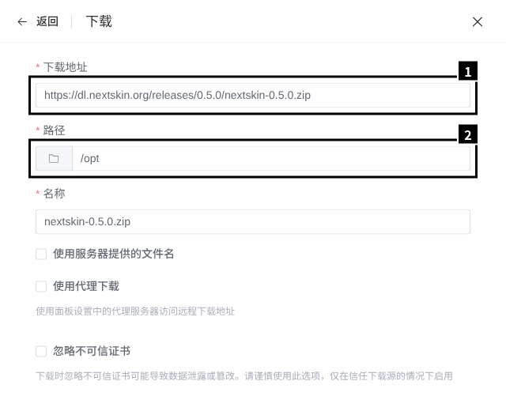

1. 填 `https://dl.nextskin.org/releases/<版本>/nextskin-<版本>.zip`，版本号换成 [GitHub Releases](https://github.com/Glasden/NextSkin/releases) 上最新的正式版（图里是 0.5.0）。
2. 路径：`/opt`。

下载完，在 ZIP 那一行点“更多 → 解压”，解压到 `/opt`：

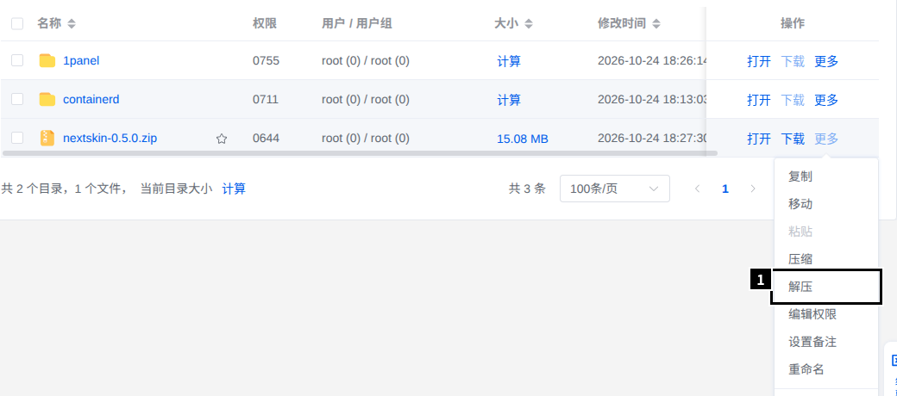

得到 `/opt/nextskin`。要核对文件，在宿主机上运行 `sha256sum /opt/nextskin-<版本>.zip`，和 Release 页 `SHA256SUMS` 里的值对一下。

## 3. 创建 Node.js 运行环境

“网站 → 运行环境 → Node.js → 创建”：

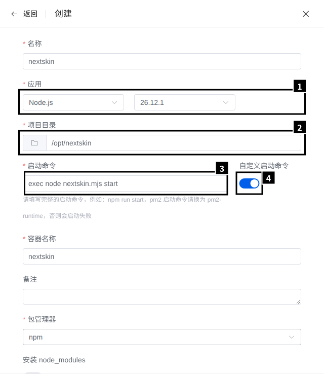

1. 应用：Node.js，版本选最新的 26。
2. 项目目录：`/opt/nextskin`。
3. 启动命令：`exec node nextskin.mjs start`，前面的 `exec` 不能少。
4. 先打开“自定义启动命令”，才能填第 3 项。

为什么要 `exec`：容器的 1 号进程是一个 bash 脚本，它执行启动命令。不加 `exec` 时 NextSkin 跑在 bash 下面，停止容器时 bash 不转发停止信号，10 秒后整个容器被强杀，站点来不及收尾。加了 `exec`，NextSkin 替换 bash 成为 1 号进程，能按顺序停下。

往下滚：

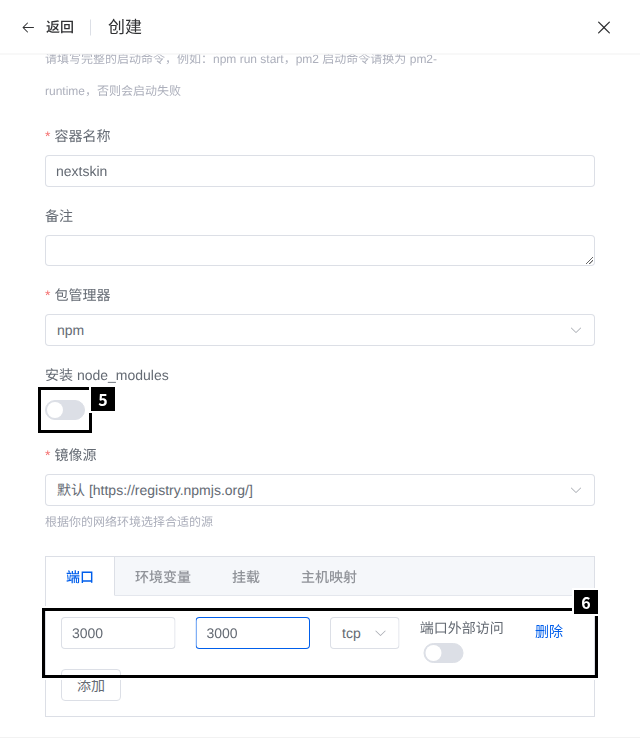

5. 关掉“安装 node_modules”：发行包不需要依赖，开着每次启动都要跑一遍 `npm install`。
6. 端口：容器端口和主机端口都填 `3000`（主机端口可以换），**关掉“端口外部访问”**，端口只发布在 `127.0.0.1` 上。Docker 发布的端口不受 ufw 管，开着就等于直接对公网开放。

“环境变量”不用填。第一次启动时 NextSkin 在项目目录里生成 `/opt/nextskin/.env`，里面是加密机密设置用的 `NEXTSKIN_SECRET`，**把它备份好**。不要设 `NEXTSKIN_HOST=127.0.0.1`：在容器里那样设，宿主机就连不进来了。

提交后等列表里的状态变成“已启动”：

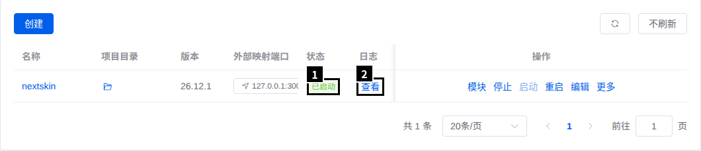

1. 已启动。
2. 起不来时点“查看”看日志。

## 4. 创建网站

“网站 → 网站 → 创建网站”，选“运行环境”：

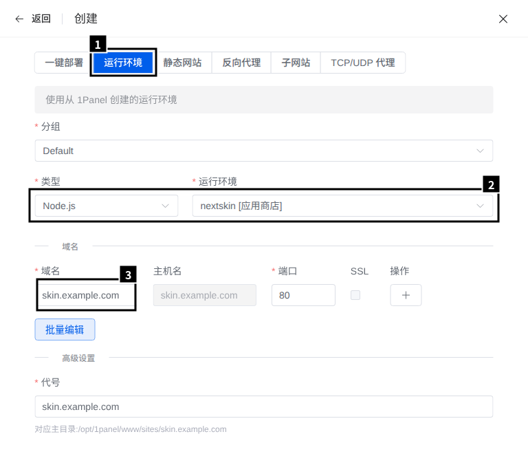

1. 选“运行环境”这一类。
2. 类型 Node.js，运行环境选刚建的 `nextskin`。
3. 域名：填你的域名。

这样建出来的网站，反向代理的 `Host`、`X-Forwarded-Proto` 都是对的，上传上限 50 MB，不用改配置文件（实测）。

## 5. 配置 HTTPS

先准备证书，在“网站 → 证书”里：

- 有自己的证书（买的、或者 CDN 给的源站证书）：点“上传证书”，把私钥和证书粘进去。
- 申请免费证书：点“申请证书”：

  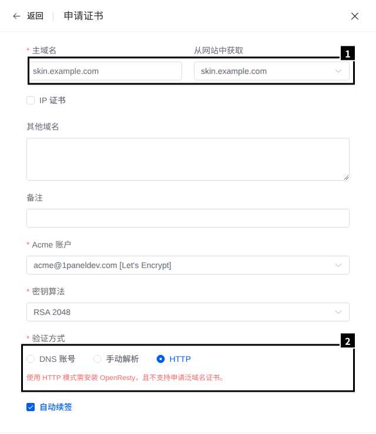

  1. 主域名：从网站里选你的域名。
  2. 验证方式：HTTP 要求域名已经解析到这台服务器、80 端口能从公网访问；做不到就用 DNS 账号或手动解析。

:::note
测试机没有公网域名，申请证书只截了表单，没有实际申请；上传证书和下面的启用 HTTPS 是实测的。
:::

然后在网站列表里点这个网站的“配置”，打开左边的“HTTPS”：

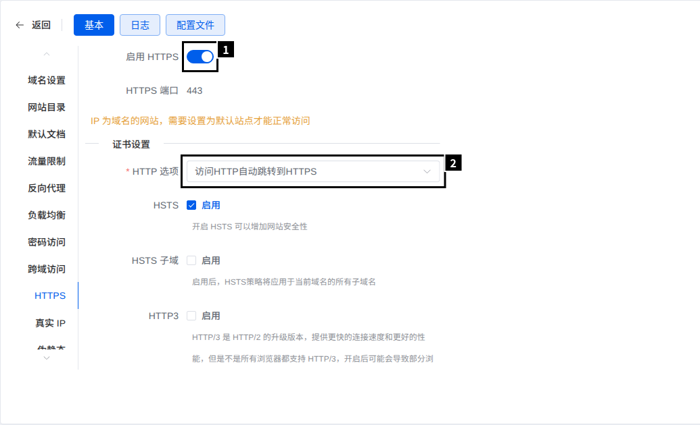

1. 打开“启用 HTTPS”。
2. HTTP 选项：访问 HTTP 自动跳转到 HTTPS。

往下滚：

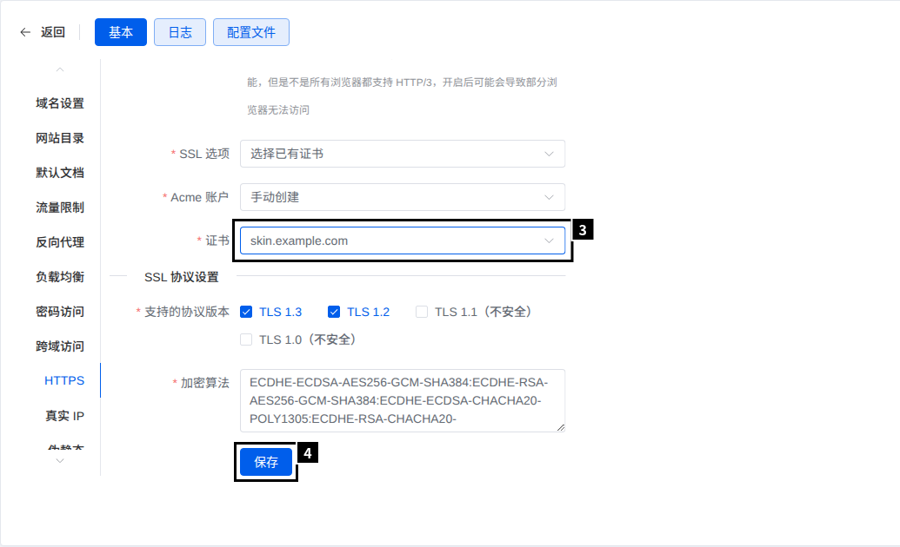

3. SSL 选项选“选择已有证书”，证书选上一步准备的那张。
4. 保存。

## 6. 建站

在“主机 → 文件”里打开 `/opt/nextskin/data`，点 `setup-code` 打开：

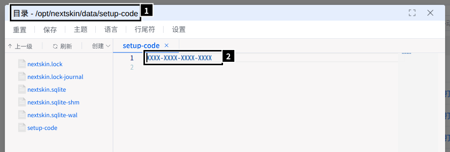

1. 文件位置。
2. 安装码。

然后打开 `https://skin.example.com/setup`，照[建站](/guide/install/#建站)的步骤做。建好站以后别忘了[生成签名私钥](/guide/install/#生成签名私钥)，否则外置登录不可用。

## 7. 设置受信任的反向代理

OpenResty 和 NextSkin 不在同一个容器里，NextSkin 看到的对端地址是 `1panel-network` 这个 Docker 网络的网关，不是访客。不告诉它这个网关可信，所有访客的 IP 都会被记成网关的地址，按 IP 的注册限制和限流对所有人一起生效。

查网关地址（实测是 `172.18.0.1`）：

```bash
docker network inspect 1panel-network -f '{{range .IPAM.Config}}{{.Gateway}}{{end}}'
```

在后台“设置 → 高级”，把它加进“受信任的反向代理”，一行一个：

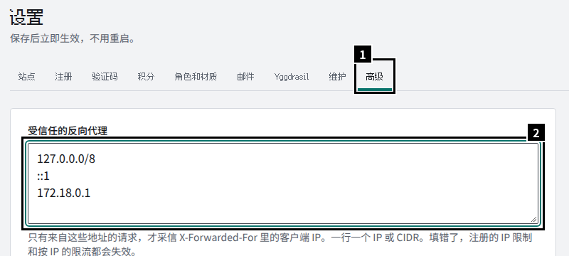

1. 高级。
2. 在默认的两行下面加上网关地址，保存。

核对：随便改一项设置再改回来，然后看后台的“审计日志”：

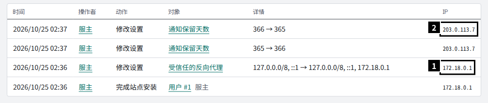

1. 加之前记的是网关的地址。
2. 加之后记的是你自己的公网 IP，这就对了。

审计日志只记管理操作，不记登录，所以要做一次改动才看得到新的记录。

## 日常操作

- **停止、启动、重启**：在运行环境列表里操作。
- **日志**：运行环境列表的“查看”，或者 `/opt/nextskin/data/logs/nextskin.log`，后台的“诊断”页也能看。
- **命令行**：在容器里执行，容器名是创建时填的“容器名称”：

  ```bash
  docker exec nextskin node /app/nextskin.mjs doctor
  ```

- **防火墙**：安装 1Panel 时会在 ufw 里放行面板端口；运行后还多了对所有来源放行 80、443 的规则（注释 `1panel-rule`），卸载 1Panel 时不会删。服务器上本来就有自定义规则的，装面板前后用 `ufw status numbered` 对比一下。

## 升级

在后台的“更新”页一键升级，步骤见[升级与回退](/guide/upgrade/)。实测 0.5.0 → 0.7.0：准备约 8 秒，升级时站点停 2–3 秒；回滚约 5 秒。

- 升级不重建容器：项目目录挂在容器里、可写，管理进程是容器的 1 号进程，原地换版本。之后在面板里重启，运行的仍是升级后的版本（实测）。
- Node 版本由运行环境决定，不会跟着升级。新版本要求更新的 Node 时，“更新”页的预检会拦下：先编辑运行环境、换成新的 Node 版本（会重建容器，项目目录不受影响），再升级。
- 命令行的 `update`、`rollback` 也在容器里执行，例如 `docker exec nextskin node /app/nextskin.mjs update status`。
- 手动升级：在面板里停止运行环境 → 备份 `/opt/nextskin/data` 和 `.env` → 把新的 ZIP 解压到 `/opt`、覆盖原有文件 → 启动。
