本页的截图来自宝塔 Linux 面板 13.1.0（Ubuntu 24.04），2026 年 10 月实测。面板版本不同时按钮的位置可能不一样，要点不变。

宝塔用“Node项目”以 `www` 用户运行 NextSkin，同机的 Nginx 做反向代理和 HTTPS。全程在面板里操作，只有写配置文件那一步要在面板的终端里运行一行命令。

:::note[示例值]
文中的域名 `skin.example.com` 换成你自己的。
:::

## 1. 安装 Nginx 和 Node

第一次登录面板会弹出“初始化推荐配置”。在 LNMP 一栏只勾 Nginx，点“一键安装”：

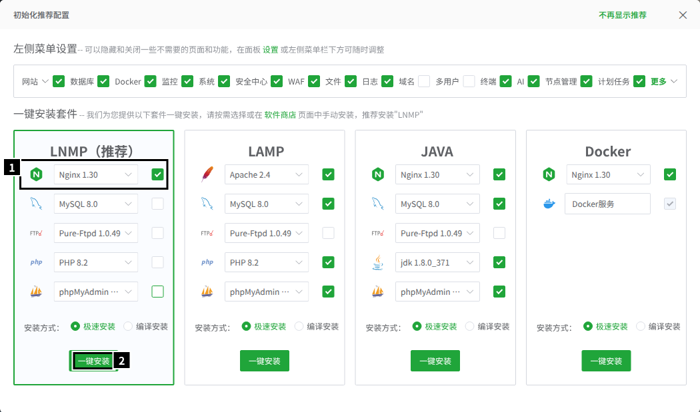

1. 只留 Nginx。NextSkin 默认用 SQLite，不需要 MySQL、PHP、FTP 和 phpMyAdmin。要用 MySQL 也可以一起装，见[配置与进程](/guide/install/configuration/#数据库)。
2. 一键安装。ARM 服务器上 Nginx 要从源码编译，十几分钟；等它装完再继续。

已经关掉了这个弹窗的，到“软件商店”里搜索 Nginx 安装。

然后打开“网站 → Node项目”。第一次打开会提示没有装 Node 版本管理器，点“点击安装”：

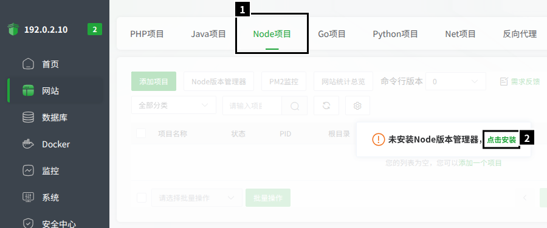

装好以后点“Node版本管理器”，安装最新的 v26：

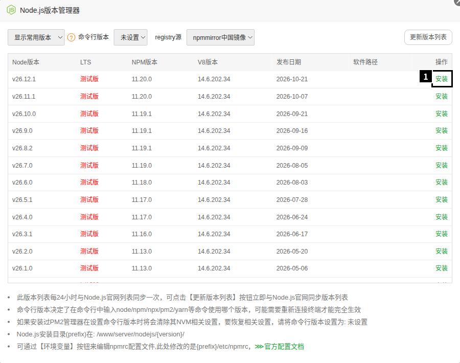

宝塔把还没进入 LTS 的版本都标成“测试版”，照样装 v26。v24、v25 也能运行，但 plugin host 拦不住插件绕过站点直接连网。

装好后把“命令行版本”设成刚装的版本：

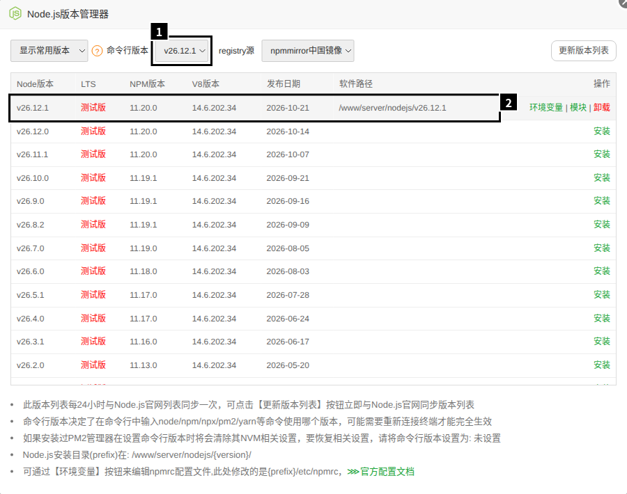

1. 命令行版本：设了以后终端里能直接用 `node`，后面运行 `doctor` 等命令要用到。
2. 装好的 Node 在 `/www/server/nodejs/<版本>`。

## 2. 下载发行包

打开“文件”，进入 `/www/wwwroot`，点“上传/下载 → URL链接下载”：

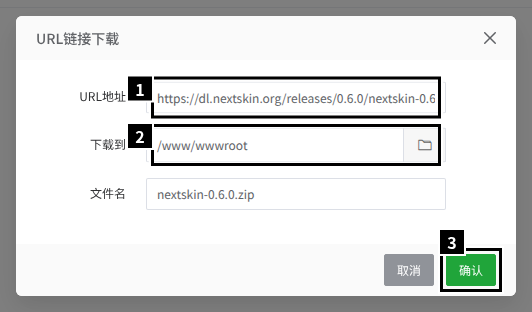

1. 填 `https://dl.nextskin.org/releases/<版本>/nextskin-<版本>.zip`，版本号换成 [GitHub Releases](https://github.com/Glasden/NextSkin/releases) 上最新的正式版（图里是 0.6.0）。
2. 下载到 `/www/wwwroot`。
3. 确认。

要核对文件：文件页上方有“终端”按钮，打开时就在当前目录，运行 `sha256sum nextskin-<版本>.zip`，和 Release 页 `SHA256SUMS` 里的值对一下。

下载完，在 ZIP 那一行点“更多 → 解压”，解压到 `/www/wwwroot`：

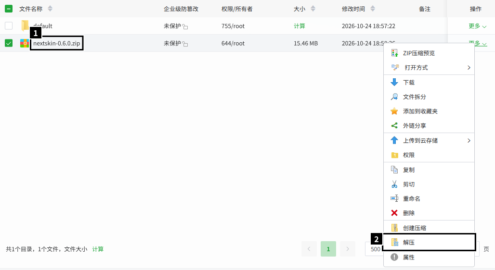

得到 `/www/wwwroot/nextskin`。ZIP 可以删掉了。

## 3. 写配置文件

进入 `/www/wwwroot/nextskin`，点“终端”，运行：

```bash
printf 'NEXTSKIN_SECRET=%s\nNEXTSKIN_HOST=127.0.0.1\nNEXTSKIN_PORT=3000\n' "$(openssl rand -hex 32)" > .env
chmod 600 .env
```

- `NEXTSKIN_SECRET` 加密后台保存的机密设置。**把 `.env` 下载下来备份**：丢了它，SMTP 密码这类设置都要重填。
- `NEXTSKIN_HOST=127.0.0.1`：只让同机的 Nginx 访问，3000 端口不对外。不写 `.env` 也能启动（会自动生成一份只有密钥的），但那样会监听所有网卡。
- 文件属于 root 不要紧：宝塔每次启动项目前会把整个项目目录交给运行用户 `www`。

## 4. 添加 Node 项目

“网站 → Node项目 → 添加项目”，用“默认项目”这一页：

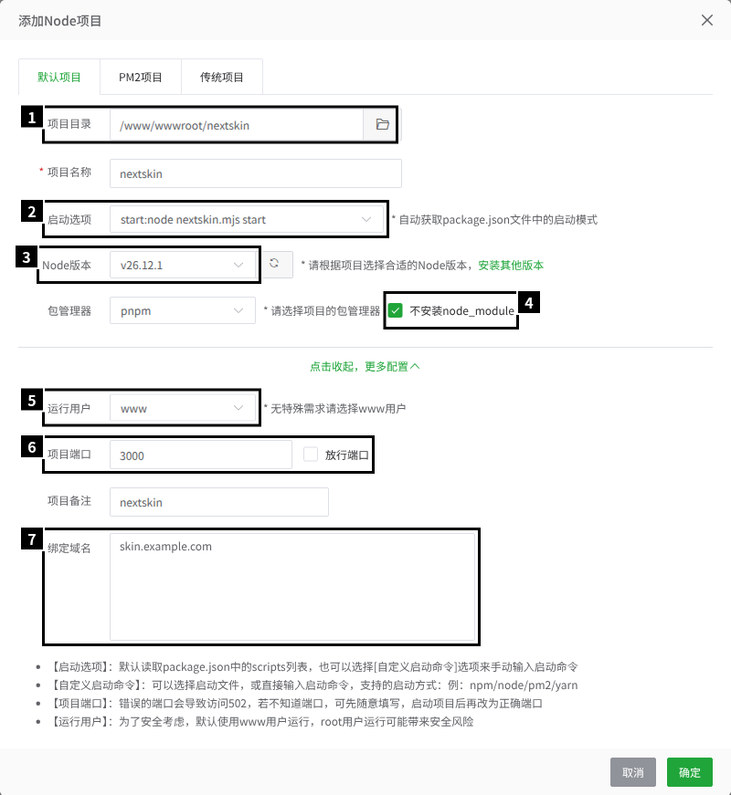

1. 项目目录：点右边的文件夹图标，选 `/www/wwwroot/nextskin`。用选择器选，宝塔才会读 `package.json`，自动填好项目名称和启动选项；手打路径不会。
2. 启动选项：`start:node nextskin.mjs start`。
3. Node版本：刚装的 v26。
4. 勾上“不安装node_module”。发行包不需要依赖，包管理器选哪个都行。
5. 点“更多配置”展开。运行用户：`www`。
6. 项目端口：`3000`，和 `.env` 里一样。**不要**勾“放行端口”：访客经 Nginx 访问，不需要直接打开 3000。
7. 绑定域名：填你的域名，宝塔据此生成 Nginx 配置。

确定以后项目自动启动，列表里显示“运行中”。进程是 `npm run start` → 管理进程 → 启动器 → 核心，都以 `www` 运行，只监听 `127.0.0.1:3000`。

## 5. 配置 HTTPS

在项目那一行点“设置”，打开“SSL”页签。

**有自己的证书**（买的、或者 CDN 给的源站证书）：在“当前证书”里把私钥和证书分别粘进去，点下面的保存按钮，然后打开“强制HTTPS”：

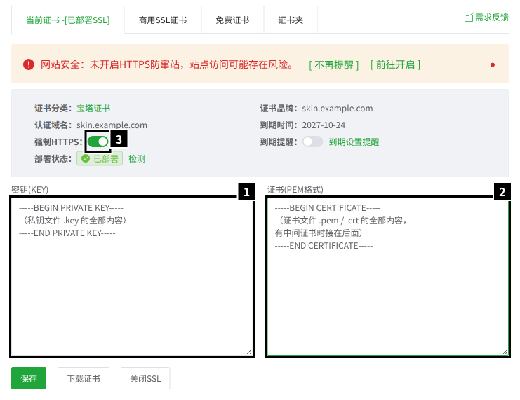

1. 密钥（KEY）：私钥文件的全部内容。
2. 证书（PEM格式）：证书文件的全部内容，有中间证书时接在后面。
3. 强制HTTPS：证书部署好以后再打开，HTTP 的访问会 301 跳转到 HTTPS。

**申请免费证书**：在“免费证书”页签点“申请证书”：

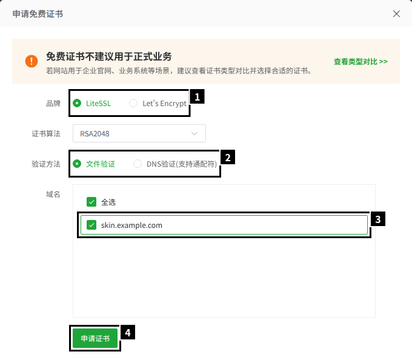

1. 品牌：LiteSSL 和 Let's Encrypt 都行。
2. 验证方法：文件验证要求域名已经解析到这台服务器、80 端口能从公网访问；做不到就用 DNS 验证。
3. 勾上你的域名。
4. 申请证书。签下来以后同样打开“强制HTTPS”。

“商用SSL证书”页签是宝塔卖的付费证书，不需要。

:::note
测试机没有公网域名，免费证书只截了表单，没有实际申请；粘贴证书和强制 HTTPS 是实测的。
:::

## 6. 改反向代理配置

宝塔生成的 Nginx 配置里，`location /` 写的是 `proxy_set_header Host $host:$server_port;`，而且不带 `X-Forwarded-Proto`。照原样运行，HTTPS 站点的外置登录地址会被算成 `http://skin.example.com:443/api/yggdrasil`（实测），启动器和皮肤站模组都连不上。

在项目设置的“配置文件”页签里，把 `location /` 里的 `Host` 那一行改掉，紧接着加一行 `X-Forwarded-Proto`：

```nginx
proxy_set_header Host $http_host;
proxy_set_header X-Forwarded-Proto $scheme;
```

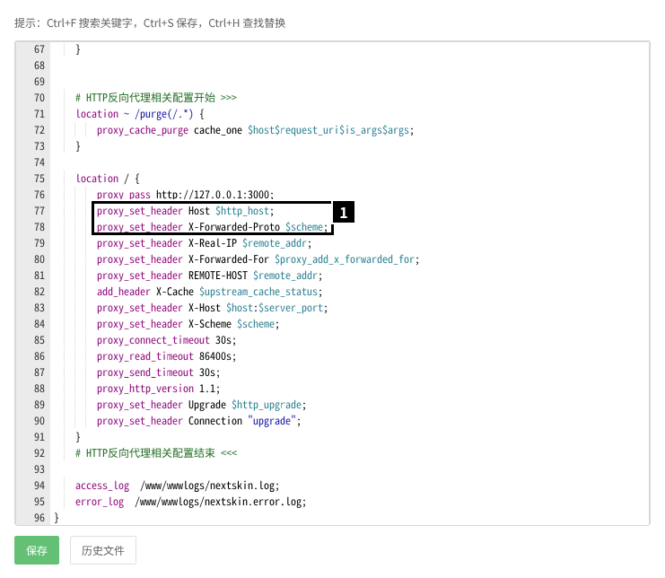

其余行不用动。点“保存”，Nginx 马上用上新配置。上传大小的上限宝塔已经在 Nginx 全局设成了 50 MB，不用另加 `client_max_body_size`。

:::caution[改过的两行会被冲掉]
在项目设置的“项目配置”页签点“保存修改”时，宝塔会按模板重新生成反向代理这一段，手改的两行就没了（实测）。开关 SSL、强制 HTTPS 只插入它们自己的几行，不受影响（实测）。改过项目设置以后，照[检查](/guide/install/#检查)看一眼外置登录的地址，不对就重改。

想一劳永逸，可以改模板 `/www/server/panel/vhost/template/nginx/node_http.conf` 里的 `{host}:$server_port`，但这会影响这台机器上所有的 Node 项目，面板升级时也可能被还原。
:::

## 7. 建站

在文件页打开 `/www/wwwroot/nextskin/data`，双击 `setup-code`，它在在线文本编辑器里打开：

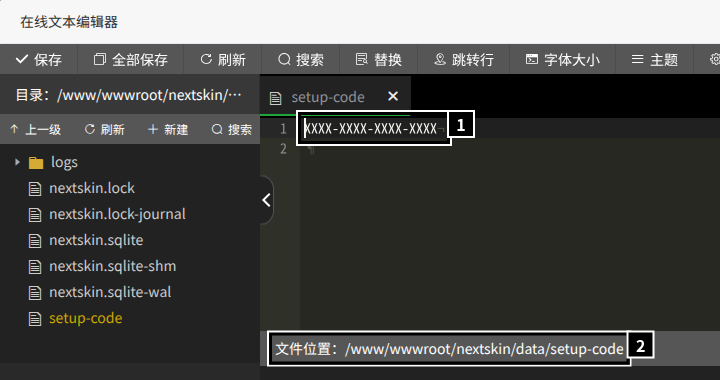

1. 安装码。
2. 文件位置。

然后打开 `https://skin.example.com/setup`，照[建站](/guide/install/#建站)的步骤做。建好站以后别忘了[生成签名私钥](/guide/install/#生成签名私钥)，否则外置登录不可用。

Nginx 和 NextSkin 在同一台机器上，“受信任的反向代理”用默认值就行，审计日志里记的是访客的真实 IP（实测）。

## 日常操作

- **停止、启动**：在项目列表里点状态（“运行中”）→ 确定。停止时三层进程 1 秒内都退出（实测）。
- **重启**：项目设置 → “服务”页签 → 重启。站点停 1 秒左右，期间 Nginx 返回 502（实测）。
- **日志**：`/www/wwwroot/nextskin/data/logs/nextskin.log`，后台的“诊断”页也能看。
- **命令行**：用运行用户 `www` 执行，否则数据目录里会出现服务读写不了的文件：

  ```bash
  sudo -u www node /www/wwwroot/nextskin/nextskin.mjs doctor
  ```

  `node` 是第 1 步设的命令行版本。没设时用绝对路径 `/www/server/nodejs/<版本>/bin/node`。

## 升级

在后台的“更新”页一键升级，步骤见[升级与回退](/guide/upgrade/)。实测 0.6.0 → 0.7.0：准备约 8 秒，升级时站点停 1 秒左右；回滚约 7 秒。

- 升级不经过宝塔：管理进程原地换版本，宝塔的项目不重启。之后在宝塔里停止、启动、重启，运行的都是升级后的版本（实测）。
- 宝塔每次启动前把项目目录交给 `www`，管理进程写得了 `releases/`，所以能一键升级。代价是站点本身（同一个用户）也能改程序文件，做不到 [systemd](/guide/install/systemd/) 那样的权限分离。
- Node 是面板装的，不会跟着升级。新版本要求更新的 Node 时，“更新”页的预检会拦下：先在 Node版本管理器里装新版本，在“项目配置”里换过去，再升级。换完 Node 点了“保存修改”，记得重改[反向代理那两行](#6-改反向代理配置)。
- 手动升级：停止项目 → 备份 `data/` 和 `.env` → 把新的 ZIP 下载到 `/www/wwwroot`，解压时覆盖原有文件 → 启动项目。
