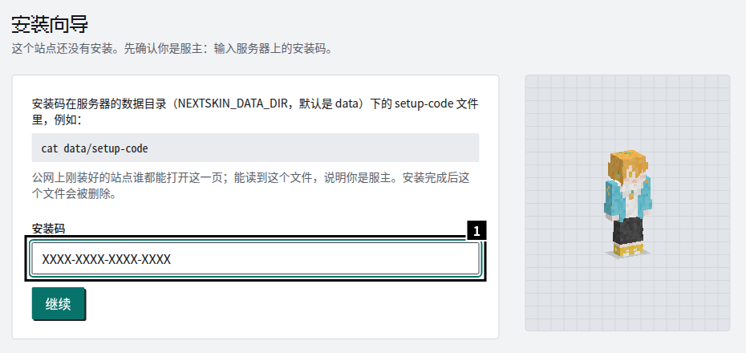
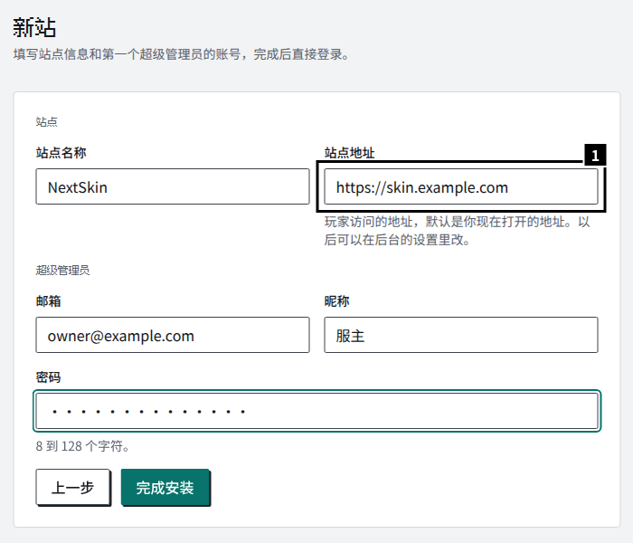
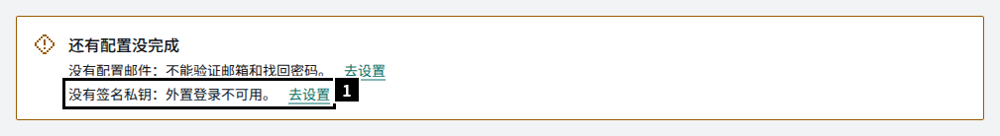
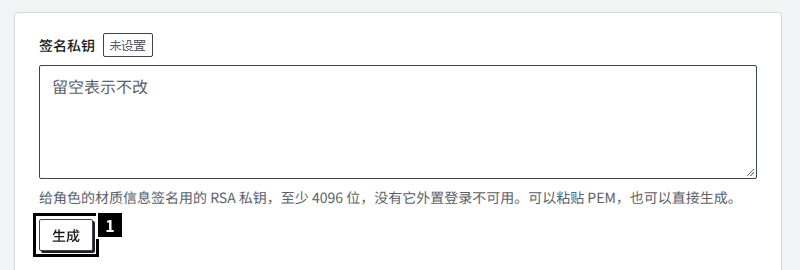

NextSkin 只需要 Node 和一个可写的数据目录：默认用 SQLite，不需要 Redis、消息队列或 pm2。发行包里是管理进程、启动器和站点本身，解压后用 Node 运行，不用 `npm install`。

## 选择安装方式

| 方式 | 适合 | 一键升级 |
| --- | --- | --- |
| [宝塔面板](/guide/install/baota/) | 已经在用宝塔，想全程在界面里操作 | 支持 |
| [1Panel](/guide/install/1panel/) | 已经在用 1Panel | 支持 |
| [Docker](/guide/install/docker/) | 熟悉容器，想要只读的根文件系统 | 不支持，换镜像标签升级 |
| [systemd](/guide/install/systemd/) | 不装面板的 Linux 服务器 | 支持 |
| [Windows](/guide/install/windows/) | Windows 服务器，或者先在自己电脑上试试 | 支持 |

宝塔和 1Panel 的页面是图文步骤，面板会替你配好反向代理和证书。其余方式要自己配反向代理，见[反向代理与 HTTPS](/guide/install/reverse-proxy/)。环境变量、停止和重启、日志见[配置与进程](/guide/install/configuration/)，以后的版本怎么升级见[升级与回退](/guide/upgrade/)。

## 环境要求

| 用途 | 要求 |
| --- | --- |
| 运行发行包 | Node 24 或更新，推荐 26（24、25 上 plugin host 拦不住插件绕过站点直接连网，`start` 和 `doctor` 会提示） |
| Docker | 没有额外要求，镜像自带运行时 |
| 数据库 | 默认 SQLite，不用另装；也可以用 MySQL、MariaDB、PostgreSQL（测试覆盖 MySQL 8.4、MariaDB 10.11、PostgreSQL 15） |
| 内存 | 空闲时合计 350 MB 左右：核心约 200 MB，启动器、管理进程各约 60 MB（Docker 里没有管理进程） |

从源码运行、改代码见[本地开发](/development/)。

## 下载和核对

发行包是一个 ZIP，所有平台通用：

- [GitHub Releases](https://github.com/Glasden/NextSkin/releases)：`nextskin-<版本>.zip`，同一页有 `SHA256SUMS` 和 `SHA256SUMS.sig`。
- `https://dl.nextskin.org/releases/<版本>/nextskin-<版本>.zip`：同一个文件，国内下载快一些，站点一键升级也先从这里下载。这里只有 ZIP，核对用的 `SHA256SUMS` 还是从 GitHub 那一页取。

下载后核对：

```bash
sha256sum -c SHA256SUMS
```

`SHA256SUMS.sig` 是发布时用 NextSkin 的发布私钥对 `SHA256SUMS` 签的名，站点检查更新、下载升级包时也认这把钥匙。要确认 `SHA256SUMS` 本身没被换过，下载[发布公钥](/release-keys/2026-10.pem)，用 OpenSSL 3 核对：

```bash
openssl pkeyutl -verify -pubin -inkey 2026-10.pem -rawin -in SHA256SUMS -sigfile SHA256SUMS.sig
```

## 解压后的目录

```
nextskin/                 实例目录
├─ nextskin.mjs           入口：管理进程和命令行，面板、systemd 都运行它
├─ manager/               管理进程：选版本启动、监管、升级、回滚
├─ releases/
│  ├─ <版本>/             一个版本的程序，运行时不改
│  ├─ current.json        指针：当前版本、上一个版本，第一次 start 时生成
│  └─ update-log.jsonl    每次升级、回滚的结果
├─ package.json           只有 scripts.start = "node nextskin.mjs start"，给面板用
├─ README.md  .env.example
├─ .env                   配置；没有时第一次 start 生成（权限 600），存 NEXTSKIN_SECRET
└─ data/                  数据目录：SQLite 库、材质、插件、日志、setup-code、backups/
```

- **备份 `.env`**：里面的 `NEXTSKIN_SECRET` 加密了后台保存的机密设置（SMTP 密码、OAuth secret 等），丢了这些设置要重填。
- `data/` 要让运行服务的用户能写。备份站点就是备份 `data/` 和 `.env`。
- `releases/` 里平时有两个版本：在用的和上一个（留作回滚）。

## 建站

服务第一次启动后，数据目录里会出现 `setup-code`，里面是安装码。打开 `https://<域名>/setup`，输入安装码：



安装码只有运行服务的用户能读，日志里只写它的位置。各安装方式的页面写了怎么读到它，面板上用文件管理器打开就行。

然后选“新站”，填站点信息和第一个超级管理员：



1. **站点地址**：填玩家实际访问的地址，例如 `https://skin.example.com`。默认是你现在打开的地址，所以先配好 HTTPS 再来建站。登录、注册要求请求的 `Origin` 和它一致，邮件链接、通行密钥也用它；填成内网地址就登录不了。以后在后台“设置 → 站点”里改；改了域名，已有的通行密钥都不能再用。

完成后直接登录后台。`setup-code` 被删除，`/setup` 返回 404。

从 Blessing Skin 迁移：在这一步选“从 Blessing Skin 导入”，或者用命令行导入，步骤见[迁移指南](https://github.com/Glasden/NextSkin/blob/main/packages/importer/MIGRATION.md)。

## 建站之后

后台“概览”会列出还没配好的项目：



### 生成签名私钥

外置登录（authlib-injector）要用一把 RSA 私钥给角色的材质信息签名。这把钥匙不会自动生成，没有它时启动器登录会失败，`/api/yggdrasil` 返回 400：“本站还没有配置签名密钥，外置登录暂时不可用”。

点上图的“去设置”（后台“设置 → Yggdrasil”），在“签名私钥”下面点“生成”，马上生效：



也可以粘贴一把自己的 PEM 私钥（至少 4096 位），例如从别的站点迁过来的。以后再点“生成”会换掉这把钥匙、不能撤销；已经接入的游戏服务器要重启才拿得到新的公钥，重启之前玩家的皮肤可能显示不出来。

### 配置邮件

邮箱验证、找回密码要先在“设置 → 邮件”里配 SMTP。不配也能用，只是这两样功能不可用。

### 检查

```bash
node nextskin.mjs doctor                                  # 在实例目录里，用运行服务的用户
curl -s https://skin.example.com/api/health               # {"status":"ok"}
curl -s https://skin.example.com/api/yggdrasil | head -c 200   # 有 meta 和 signaturePublickey
curl -s -o /dev/null -D - https://skin.example.com/api/health | grep -i x-authlib-injector-api-location
```

最后一条应该输出 `https://skin.example.com/api/yggdrasil`。协议成了 `http://`、或者多了 `:443` 这样的端口，就是反向代理的 `Host`、`X-Forwarded-Proto` 没配好，见[反向代理与 HTTPS](/guide/install/reverse-proxy/#nginx)。后台“设置 → Yggdrasil”里关掉了“返回 API 地址指示”时没有这个头，先打开再核对。

## 接下来

- [升级与回退](/guide/upgrade/)：后台一键升级、命令行升级、回到上一个版本
- [命令行](/guide/commands/)：检查、提权、找回超级管理员、管理插件
- 安装插件：后台的“插件”页上传 `.tgz`，或者用 `nextskin plugin install`
- 玩家怎么在游戏里用：[玩家指南](/players/)
