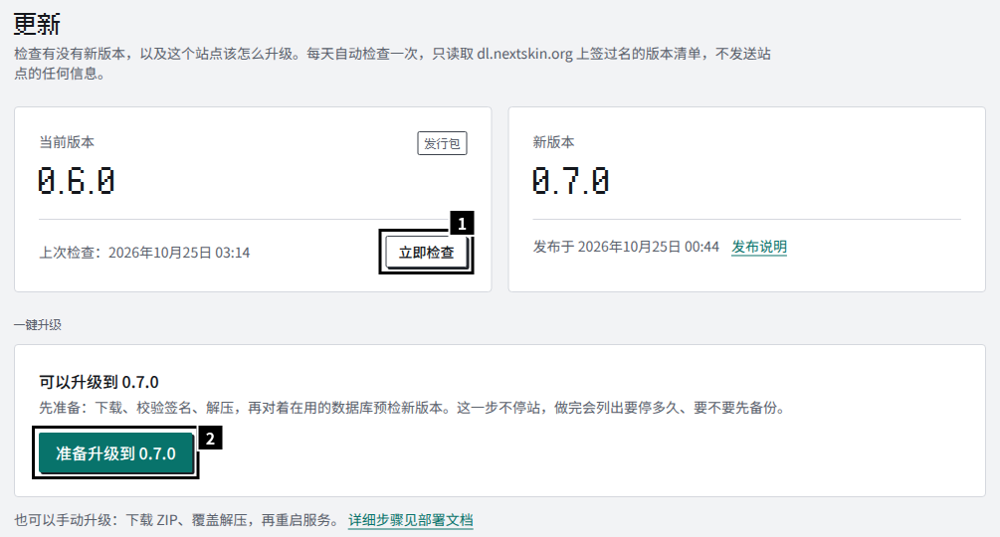
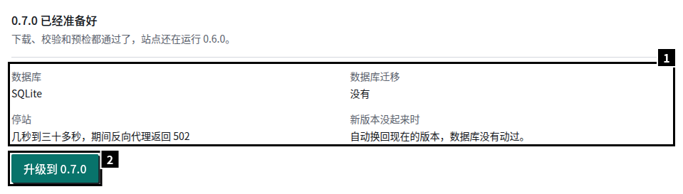
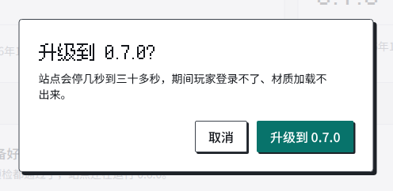
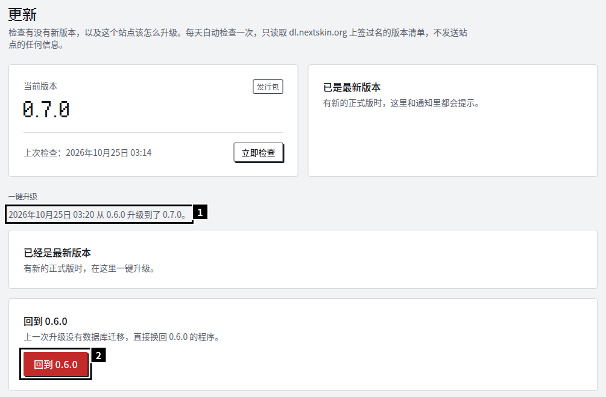
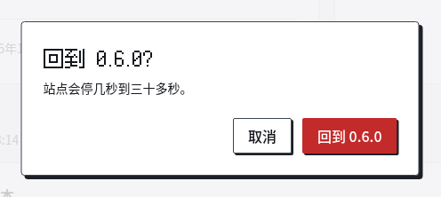

- **迁移是单向的**：升级到带数据库迁移的版本以后，旧版本打不开这个库。升级前先读发布说明；要不要停站、有几个迁移、失败时会怎样，以后台的预检结果为准。
- **检查新版本**：站点每天读一次 `https://dl.nextskin.org/releases/v1.json`（签过名的版本清单，请求里不带站点的任何信息），有新版本时后台的概览和“更新”页会提示，超级管理员还会收到一条通知。不想要可以在后台“设置 → 高级”里关掉。

发行包（宝塔、1Panel、systemd、Windows）能在后台一键升级。Docker 镜像只提示、不一键升级，换标签升级，见 [Docker](/guide/install/docker/#升级与回退)。

## 后台一键升级

后台的“更新”页，只有超级管理员能进。

### 1. 准备

点“立即检查”拉一次最新的清单，有新版本时点“准备升级到 …”：

准备这一步站点照常运行：下载 ZIP（先试 `dl.nextskin.org`，再试 GitHub）、核对签名和 SHA-256、解压到 `releases/<版本>/`，再用新版本对着在用的数据库预检。

### 2. 看预检结果，升级

1. 预检结果：数据库、有没有迁移、要停多久、新版本没起来时会怎样；有和新版本不兼容的插件也列在这里。
2. 点“升级到 …”，确认：

管理进程停掉旧版本（这期间反向代理返回 502）→ 用新版本执行迁移 → 换指针 → 启动新版本，等它的 `/api/health` 返回 200（最多 2 分钟）→ 删掉在用和上一个以外的版本目录。没有迁移时站点只停几秒；迁移多、库大时可能要三十多秒。

### 3. 完成

1. 最近一次的结果。
2. 需要时可以回到上一个版本，见下面的“回滚”。

实测：宝塔上 0.6.0 → 0.7.0、1Panel 上 0.5.0 → 0.7.0（都没有迁移），准备约 8 秒，升级约 6 秒，其中站点不可用 1–3 秒。

### 新版本没起来时

| 情况 | 升级前 | 新版本没通过健康检查时 |
| --- | --- | --- |
| 没有迁移 | — | 自动换回旧版本 |
| SQLite 有迁移 | 迁移前自动备份到 `data/backups/` | 换回备份和旧版本 |
| PostgreSQL 有迁移 | 自己备份，在后台勾选“已经备份” | 迁移失败、库没变（核心的迁移整批一个事务）：换回旧版本。迁移成功但新版本没起来，或者核心的迁移提交了、插件的迁移失败：不自动回滚，新版本留着，按后台的说明用备份恢复 |
| MySQL、MariaDB 有迁移 | 同上 | 迁移失败：库可能停在中间（DDL 不能回滚），换回旧版本；旧版本打不开时就停在那里，用备份恢复。有迁移已经提交时：同上一行 |

### 要求和例外

- 运行管理进程的用户要能写 `releases/`，写不了时只检测，“更新”页说明原因。宝塔、1Panel、Windows 默认满足；systemd 照 [systemd](/guide/install/systemd/) 页的单元文件。
- 新版本要的 Node 比服务器上的新：预检拦下，先换 Node。宝塔、1Panel 怎么换见各自的页面。
- 新版本要的管理进程比在用的新（很少见）：一键升级的目标是在用的管理进程升得了的版本里最新的一个，升过去以后重启一次服务，让它带来的新管理进程生效，再升到最新。“更新”页会写明这几步；没有这样的中间版本时，只能照“手动升级”覆盖解压。
- 准备时失败（下载失败、空间不足、Node 太旧、预检没过）不影响在用的版本，修好以后再准备就行。迁移以后失败的版本会记下，“更新”页注明上次在这里失败过，命令行的 `update` 不再默认选它（`--to` 照样能选）。
- 结果记在 `releases/update-log.jsonl`，后台显示最近一次。
- 准备、升级时管理进程要下载、解压和校验，常驻内存会从 60 MB 左右涨到 150 MB 左右，不随升级次数继续涨，重启服务以后回落。

## 回滚

只能回到上一个版本（`releases/current.json` 里的 `previous`）：“更新”页的“回到 …”，或者 `node nextskin.mjs rollback`。

- 那次升级没有迁移：直接换回去。实测 5–7 秒。
- SQLite 有迁移：用那次升级前的备份换回库，**升级以后的所有写入都会丢失**，要确认。之后上传的材质文件留在存储里，由孤儿文件的回收清掉。
- MySQL、PostgreSQL 有迁移：程序不碰库，也不能在后台回滚（恢复库的时候新版本还在线、还在写库）。照这个顺序做：
  1. 停掉服务；
  2. 用升级前的备份恢复数据库；
  3. 在实例目录里运行 `node nextskin.mjs rollback --yes`：它先用旧版本核对库确实恢复了，再把指针换回旧版本；
  4. 启动服务。

## 命令行

在实例目录里，用运行管理进程的用户执行（宝塔是 `www`，systemd 是 root，1Panel 在容器里，Windows 的服务在以管理员身份打开的 PowerShell 里）：

| 命令 | 用途 |
| --- | --- |
| `node nextskin.mjs update --check` | 列出比当前新的正式版 |
| `node nextskin.mjs update [--to <版本>] [--yes] [--backup-confirmed]` | 升级，默认到最新的正式版（手动解压了更新的版本时到解压的版本）。服务运行时交给管理进程，和后台一样；服务停着时自己执行同一套流程，最后不启动服务。MySQL、PostgreSQL 有迁移时要 `--backup-confirmed`；不在终端里运行时要 `--yes` |
| `node nextskin.mjs rollback [--yes]` | 回到上一个版本，规则同上。MySQL、PostgreSQL 有迁移时只能在服务停着时运行 |
| `node nextskin.mjs update status` | 当前版本、上一个版本、进行中的操作、最近一次的结果 |
| `node nextskin.mjs releases` | 列出 `releases/` 里的版本和指针 |

参数细节见[命令行](/guide/commands/#update)。

## 手动升级

不用后台也可以：停服务 → 备份 `data/` 和 `.env` → 把新的 ZIP 覆盖解压到实例目录 → 启动。不用删任何东西。

- 启动时管理进程发现解压进来的版本比在用的新，就照一键升级的流程从预检开始（不下载），失败时同样回到旧版本。
- MySQL、PostgreSQL 有迁移时不会自己升级：照旧运行旧版本，日志说明原因。备份以后到后台“更新”页确认升级，或者停掉服务后运行 `node nextskin.mjs update --backup-confirmed`。
- 各安装方式怎么停、怎么解压，见各自页面的“升级”一节。

### 从 0.4 及更早的版本升级

0.4 及更早的发行包是旧的目录布局（根目录里直接是 `server/`、`cli/`）：

- 照“手动升级”覆盖解压新包，再启动。管理进程第一次启动时用新版本预检、迁移、启动，新版本通过健康检查后删掉根目录的 `server/`、`cli/`。
- 失败时以退出码 78 退出（面板和 systemd 不会反复重启），日志说明原因；`server/`、`cli/` 还在，排除原因后再启动会重试。
- MySQL、PostgreSQL 有迁移时同样不替你确认备份：启动以 78 退出。备份以后在服务停着时运行 `node nextskin.mjs update --backup-confirmed`，再启动。
- 这一次没有可回滚的上一个版本。要回到旧版本：停服务 → 删掉 `nextskin.mjs`、`manager/`、`releases/` → 解压旧版本的 ZIP → SQLite 照下面的“手工回退”换回备份 → 启动。

## 手工回退（SQLite）

- 手工备份 SQLite：先停服务，再拷整个 `data/`。停止后 `nextskin.sqlite-wal` 可能还在，最近的写入在里面，只拷 `nextskin.sqlite` 会丢。
- SQLite 有要执行的迁移（核心的，或者已启用的官方插件随新版本带来的）时，迁移之前自动备份到 `data/backups/nextskin-<UTC 时间>-<第一个迁移>.sqlite`（只有插件迁移时是 `<插件 id>-<迁移>`），留最近 3 份。备份失败就不迁移，日志说明原因（多半是空间或权限）。MySQL、PostgreSQL 不自动备份。
- 换回备份：停服务，把备份文件拷成 `data/nextskin.sqlite`，删掉同目录的 `nextskin.sqlite-wal`、`nextskin.sqlite-shm`，再启动对应的旧版本。
- SQLite 有迁移时，一键回滚要用到那次升级前的备份（路径记在 `releases/current.json` 的 `upgrades` 里），备份不在就拒绝。挪走了的放回原处再回滚。
