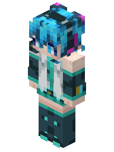
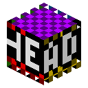
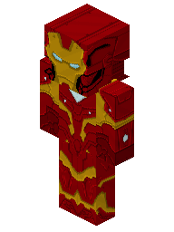

# S4 数据报告

> 由 `npm run report` 根据 `out/` 下的实测 JSON 生成，是实施方（Codex）的原始记录。结论与取舍以 [README.md](README.md) 为准。

**实施方的结论：有条件可行。** 本机验证了不依赖 sharp 的完整 PNG 上传、规范化、hash、2D/等距 3D 渲染与无损 WebP 输出；条件是选用修正后的 pngjs、强制有界解压与元数据剥离，并将上传/渲染移入 worker 和缓存。fast-png 8 的低位深 Adam7 未通过，不能单独承担解码。最终是否采纳仍由主会话决定，本 spike 不修改 ADR。

这只验证新上传的管线；ADR-0006 要求导入材质及旧 hash 原样保留，不能经过此规范化器。对应 [ADR-0008](../../docs/adr/0008-zero-native-deps.md)。

## 运行

在本目录执行，首次需要联网下载 npm 包和 11 张材质。所有运行产物在 out/，真实与合成输入分别在 fixtures/real/、fixtures/synthetic/；黄金图由显式命令更新，测试不更新基线。

```bash
npm ci
npm run fixtures
npm run check
npm test
npm run experiments
npm run audit
npm run bench
# 第二个版本必须等前一个基准完全结束，再运行：
S4_NODE26=/tmp/claude-1001/-workspace-NextSkin/ab258c0c-a8e5-45b8-9af9-be90c7818b8b/scratchpad/node26/bin/node
"$S4_NODE26" --import tsx src/bench.ts
"$S4_NODE26" --import tsx --test --test-concurrency=1 src/*.test.ts
"$S4_NODE26" --import tsx src/experiments.ts
npm run report
# 仅有意调整渲染后更新基线：npm run golden
```

npm test 同时运行像素测试与完整健壮性矩阵；后者约 50 秒，每个语料/路径用独立子进程，5 秒超时。TypeScript 固定由 lockfile 安装为 7.0.2，严格模式类型检查。Node 26 路径是本机约定，其他机器自行替换；两个版本输出按版本保存。npm run report 需要两版本的 JSON 都已生成。

| 文件 | 用途 |
|---|---|
| src/png.ts | 生产候选：probe、CRC/结构/尺寸/解压防护、双解码适配、三条 PNG 编码、上传及 A/B hash |
| src/render.ts | 生产候选：模型推断、客户端预处理、最近邻/alpha 合成、通用长方体光栅器及五种预览 |
| src/webp.ts | 生产候选：Node 加载 WebP WASM，lossless + exact |
| src/fixtures.ts、src/real-manifest.json | 固定提交下载、逐文件 SHA256 校验、确定性合成 |
| src/corpus.ts、src/robustness*.ts | 颜色格式与畸形输入生成、独立子进程资源测试 |
| src/reference.ts | dev：sharp 的独立 2D UV 布局和像素对照 |
| src/pipeline.test.ts、src/security.test.ts | node:test；像素、边界、深度、黄金及 180 次隔离检查 |
| src/golden.ts、golden/*.png | 生成 31 张黄金图，合计 199022 字节 |
| src/bench.ts | tinybench 串行基准，JSON 与逐项日志 |
| src/experiments.ts、src/wasm-init.ts | hash、尺寸、像素交叉验证、独立冷启动 WASM RSS |
| src/audit.ts、src/report.ts | 生产依赖扫描、由实测 JSON 生成本报告 |
| THIRD_PARTY.md | 图像与参考代码来源、MIT 许可声明 |
| .npmrc | npm 缓存与日志固定在 out/ |

## 材质集与来源

来自 [skinview3d 固定提交 examples/public/img](https://github.com/bs-community/skinview3d/tree/84906e983a2cf325f33f515b9a71c871f799054b/examples/public/img)，提交 **84906e983a2cf325f33f515b9a71c871f799054b**，除 panorama.png 外全部 11 张 PNG。上游仓库为 MIT，许可原文保存在 [THIRD_PARTY.md](THIRD_PARTY.md)，黄金图为这些材质的衍生图。src/real-manifest.json 保存完整 SHA256，下载后校验，不在运行时信任未固定分支。初次制作 manifest 还将内容的 Git blob SHA1 与固定提交的 GitHub tree 对照。

合成集：64×32、64×64、128×128、256×256、512×512、1024×1024，每种一张真实感和一张噪声，共 12 张。真实感由 hatsune_miku 最近邻整数倍放大，64×32 取原图上半；噪声是种子 0x12345678 的 xorshift32，每个 RGBA 通道独立取低 8 位，包括随机 alpha，便于复现最差压缩情况。

## PNG 边界与像素规则

probe 只读 8 字节签名和首个 IHDR，不解压。安全解码随后限制输入 16 MiB、默认宽/高各 1024、filtered scanlines 最多 9 MiB；实际预期长度按颜色类型、位深和 Adam7 每个 pass 计算。node:zlib inflateSync(maxOutputLength=精确预期长度) 先检查，长度不符也拒绝。代价是正常图片解压两次，见后面的单独防护基准。RGBA8 最大 4 MiB；16 位中间数据最多约 8 MiB。

最多允许 4096 个块，避免小块对象数量放大内存；校验每块 CRC、IHDR 首位及唯一、IDAT 连续、PLTE/tRNS 顺序、必须有 IEND。尾随数据有意接受并丢弃。解码器只收到 IHDR/PLTE/tRNS/IDAT/IEND，其余块全部剥除，包括 tEXt/zTXt/iTXt/iCCP/gAMA/eXIf 与 APNG 控制/帧数据，避免 iCCP 的第二个解压攻击面，也保证不做颜色管理。APNG 语料含第二帧，结果仅为默认 IDAT 图像。

支持所有合法组合：灰度 1/2/4/8/16 位，RGB 8/16 位，调色板 1/2/4/8 位，灰度 alpha 与 RGBA 8/16 位，分别非隔行/Adam7，共 30 个组合。使用独立的 PNG 扫描行生成器，直接给出预期 RGBA，防止两个库犯同一个错误而互相证明。

**不能直接调用库的默认 API：**

- pngjs 7 默认 tRNS 会把 RGB 一起清零；这里对灰度/RGB 先去 tRNS，解码原始样本后自行匹配透明色，只改 alpha。
- pngjs 默认 16 位缩放是四舍五入，不是游戏的高字节截断；使用 skipRescale:true，然后每通道显式 v >>> 8。
- fast-png 非隔行低位深仍是打包数据，此处自行拆位；其 Adam7 实现不支持打包低位深，6 个组合失败。该实验适配器保留失败，不静默回退。
- fast-png 默认不校验 CRC，原始路径故意按默认行为实测；安全路径先校验原文件所有块并显式 checkCrc:true。

来源：[pngjs normaliser](https://unpkg.com/pngjs@7.0.0/lib/format-normaliser.js)、[pngjs parser](https://unpkg.com/pngjs@7.0.0/lib/parser-sync.js)、[fast-png 8 decoder](https://github.com/image-js/fast-png/blob/v8.0.0/src/png_decoder.ts)、[fast-png Adam7](https://github.com/image-js/fast-png/blob/v8.0.0/src/helpers/decode_interlace_adam7.ts)。

皮肤宽须为 64 的倍数，高等于宽或半宽；默认宽上限 1024，可下调/上调，但独立的 9 MiB 解压预算仍生效。披风接受 64×32 或 22×17 的**同一整数倍**，后者左上角对齐补透明到 64×32 的同倍尺寸，补边后的宽仍须满足上限。渲染接收已验证的 RGBA，复查尺寸形状但不重套默认 1024 上限；测试覆盖自定义 1088 上限后的旧格式皮肤和披风。46×22 等其它格式未纳入任务范围。

上传不会修改任何已解码 RGBA，包括 alpha=0 的隐藏 RGB。渲染所需的不透明修正在拷贝上进行，不回写用于规范化/hash 的像素。16 位在显式降到 RGBA8 后才保留字节；没有色彩变换。

## 健壮性实测

Node v24.21.0。每格为“接受/拒绝 · 耗时 ms / 峰值 RSS MiB · 错误编号”。耗时不含子进程启动/import/读文件，RSS 是 process.resourceUsage().maxRSS，**含 Node/tsx/两库的启动基线，空输入四路径为 67.7–68.8 MiB**，不是增量；单次冷测试，不是性能基准。全部 180 次均在 5 秒内结束。safe-pngjs 对 45 个语料的接受/拒绝与预期一致，合法项逐像素一致。raw 表示未防护的库默认 API。

| 语料 | fast-png 原样 | pngjs 原样 | 防护 fast-png | 防护 pngjs |
| --- | --- | --- | --- | --- |
| huge-IHDR | 拒绝 · 31.66 / 69.1 · E1 | 拒绝 · 31.75 / 71.2 · E2 | 拒绝 · 0.48 / 67.7 · E3 | 拒绝 · 0.48 / 69.9 · E3 |
| IDAT-200MiB | 接受 · 832.37 / 671.7 | 拒绝 · 6.00 / 70.3 · E4 | 拒绝 · 1.90 / 68.3 · E5 | 拒绝 · 1.94 / 68.2 · E5 |
| Adam7-IDAT-200MiB | 接受 · 824.03 / 671.9 | 拒绝 · 241.09 / 471.7 · E6 | 拒绝 · 2.04 / 68.7 · E7 | 拒绝 · 2.09 / 68.9 · E7 |
| bad-CRC | 接受 · 3.09 / 68.1 | 拒绝 · 1.20 / 68.9 · E8 | 拒绝 · 0.84 / 68.8 · E9 | 拒绝 · 0.77 / 68.5 · E9 |
| truncated | 拒绝 · 2.77 / 69.4 · E10 | 拒绝 · 1.08 / 68.4 · E11 | 拒绝 · 0.81 / 69.5 · E12 | 拒绝 · 0.83 / 68.4 · E12 |
| missing-IEND | 拒绝 · 2.66 / 69.0 · E10 | 拒绝 · 0.99 / 69.5 · E11 | 拒绝 · 0.95 / 69.9 · E13 | 拒绝 · 0.81 / 69.1 · E13 |
| IDAT-before-IHDR | 接受 · 3.07 / 69.8 | 拒绝 · 0.53 / 68.8 · E6 | 拒绝 · 0.45 / 70.4 · E14 | 拒绝 · 0.45 / 69.0 · E14 |
| trailing-data | 接受 · 3.51 / 69.2 | 拒绝 · 1.14 / 68.1 · E6 | 接受 · 6.45 / 68.9 | 接受 · 8.43 / 69.4 |
| JPEG | 拒绝 · 0.73 / 69.7 · E15 | 拒绝 · 0.46 / 70.2 · E6 | 拒绝 · 0.50 / 69.6 · E14 | 拒绝 · 0.44 / 68.7 · E14 |
| GIF | 拒绝 · 0.54 / 68.4 · E15 | 拒绝 · 0.50 / 69.0 · E6 | 拒绝 · 0.44 / 69.2 · E14 | 拒绝 · 0.48 / 68.9 · E14 |
| SVG | 拒绝 · 0.55 / 69.2 · E15 | 拒绝 · 0.44 / 69.7 · E6 | 拒绝 · 0.46 / 68.3 · E14 | 拒绝 · 0.47 / 68.2 · E14 |
| empty | 拒绝 · 2.51 / 68.8 · E15 | 拒绝 · 0.43 / 67.7 · E11 | 拒绝 · 0.47 / 68.6 · E14 | 拒绝 · 0.44 / 68.6 · E14 |
| metadata-and-tail | 接受 · 3.45 / 68.2 | 拒绝 · 1.33 / 69.2 · E6 | 接受 · 6.54 / 69.0 | 接受 · 9.17 / 69.3 |
| iCCP-200MiB | 接受 · 770.76 / 471.8 | 接受 · 3.33 / 69.3 | 接受 · 6.95 / 69.1 | 接受 · 7.08 / 70.5 |
| APNG-default | 接受 · 2.91 / 68.4 | 接受 · 3.64 / 69.2 | 接受 · 6.43 / 69.6 | 接受 · 6.28 / 69.4 |
| ct0-d1-plain | 接受 · 1.81 / 69.3 | 接受 · 6.05 / 68.7 | 接受 · 5.41 / 69.3 | 接受 · 8.03 / 69.9 |
| ct0-d1-adam7 | 拒绝 · 1.82 / 69.0 · E16 | 接受 · 6.66 / 69.1 | 拒绝 ⚠像素错 · 3.59 / 69.7 · E16 | 接受 · 8.55 / 69.4 |
| ct0-d2-plain | 接受 · 2.28 / 68.6 | 接受 · 8.73 / 70.0 | 接受 · 5.88 / 68.5 | 接受 · 12.62 / 69.4 |
| ct0-d2-adam7 | 拒绝 · 1.99 / 68.6 · E17 | 接受 · 9.32 / 69.0 | 拒绝 ⚠像素错 · 3.54 / 69.5 · E17 | 接受 · 9.30 / 70.1 |
| ct0-d4-plain | 接受 · 2.12 / 69.2 | 接受 · 6.48 / 69.8 | 接受 · 6.25 / 68.3 | 接受 · 9.70 / 69.0 |
| ct0-d4-adam7 | 拒绝 · 2.05 / 69.9 · E18 | 接受 · 7.32 / 68.9 | 拒绝 ⚠像素错 · 3.48 / 69.4 · E18 | 接受 · 10.31 / 68.8 |
| ct0-d8-plain | 接受 · 2.38 / 69.7 | 接受 · 3.44 / 68.3 | 接受 · 7.45 / 70.1 | 接受 · 7.16 / 69.7 |
| ct0-d8-adam7 | 接受 · 3.27 / 68.5 | 接受 · 4.14 / 67.8 | 接受 · 8.06 / 69.2 | 接受 · 8.14 / 68.7 |
| ct0-d16-plain | 接受 · 3.76 / 67.8 | 接受 · 7.95 / 70.6 | 接受 · 7.12 / 68.1 | 接受 · 9.58 / 68.9 |
| ct0-d16-adam7 | 接受 · 4.24 / 69.7 | 接受 · 7.43 / 69.9 | 接受 · 8.17 / 68.3 | 接受 · 9.23 / 69.4 |
| ct2-d8-plain | 接受 · 2.92 / 68.8 | 接受 · 4.42 / 68.7 | 接受 · 6.50 / 70.3 | 接受 · 7.79 / 69.7 |
| ct2-d8-adam7 | 接受 · 4.06 / 69.3 | 接受 · 4.18 / 69.1 | 接受 · 7.66 / 68.5 | 接受 · 8.28 / 69.5 |
| ct2-d16-plain | 接受 · 5.99 / 69.0 | 接受 · 7.82 / 69.1 | 接受 · 10.27 / 68.3 | 接受 · 11.29 / 69.9 |
| ct2-d16-adam7 | 接受 · 7.29 / 69.4 | 接受 · 9.09 / 70.8 | 接受 · 10.89 / 70.4 | 接受 · 10.69 / 69.3 |
| ct3-d1-plain | 接受 · 1.77 / 68.6 | 接受 · 7.20 / 68.1 | 接受 · 6.05 / 69.0 | 接受 · 7.92 / 70.2 |
| ct3-d1-adam7 | 拒绝 · 1.94 / 68.9 · E16 | 接受 · 6.02 / 68.9 | 拒绝 ⚠像素错 · 3.69 / 68.3 · E16 | 接受 · 9.61 / 69.4 |
| ct3-d2-plain | 接受 · 3.15 / 69.6 | 接受 · 5.50 / 69.4 | 接受 · 6.87 / 69.2 | 接受 · 8.15 / 68.9 |
| ct3-d2-adam7 | 拒绝 · 2.10 / 70.1 · E19 | 接受 · 8.44 / 69.6 | 拒绝 ⚠像素错 · 3.66 / 68.6 · E19 | 接受 · 9.19 / 71.0 |
| ct3-d4-plain | 接受 · 1.96 / 68.1 | 接受 · 5.53 / 68.5 | 接受 · 7.00 / 69.2 | 接受 · 11.03 / 70.1 |
| ct3-d4-adam7 | 拒绝 · 2.08 / 69.9 · E20 | 接受 · 6.60 / 68.8 | 拒绝 ⚠像素错 · 3.98 / 69.8 · E20 | 接受 · 8.79 / 69.3 |
| ct3-d8-plain | 接受 · 2.27 / 68.3 | 接受 · 3.88 / 69.3 | 接受 · 6.69 / 68.6 | 接受 · 6.38 / 67.8 |
| ct3-d8-adam7 | 接受 · 2.85 / 69.2 | 接受 · 4.79 / 68.6 | 接受 · 7.08 / 68.6 | 接受 · 7.35 / 70.9 |
| ct4-d8-plain | 接受 · 2.66 / 68.7 | 接受 · 3.78 / 67.9 | 接受 · 5.87 / 68.3 | 接受 · 6.86 / 69.0 |
| ct4-d8-adam7 | 接受 · 3.48 / 69.5 | 接受 · 3.83 / 68.9 | 接受 · 8.87 / 70.4 | 接受 · 6.50 / 67.9 |
| ct4-d16-plain | 接受 · 4.20 / 68.9 | 接受 · 6.58 / 70.1 | 接受 · 8.43 / 69.5 | 接受 · 9.15 / 70.5 |
| ct4-d16-adam7 | 接受 · 5.38 / 68.4 | 接受 · 7.22 / 67.7 | 接受 · 9.56 / 70.4 | 接受 · 9.00 / 69.2 |
| ct6-d8-plain | 接受 · 3.25 / 68.8 | 接受 · 3.32 / 68.3 | 接受 · 6.55 / 69.0 | 接受 · 6.22 / 69.0 |
| ct6-d8-adam7 | 接受 · 4.71 / 71.5 | 接受 · 3.85 / 67.9 | 接受 · 8.26 / 68.9 | 接受 · 6.36 / 69.7 |
| ct6-d16-plain | 接受 · 6.55 / 68.5 | 接受 · 7.23 / 69.2 | 接受 · 10.76 / 68.9 | 接受 · 9.23 / 69.8 |
| ct6-d16-adam7 | 接受 · 7.82 / 68.1 | 接受 · 7.77 / 69.2 | 接受 · 13.43 / 69.1 | 接受 · 10.64 / 70.4 |

| 编号 | 原始错误信息 |
| --- | --- |
| E1 | Array buffer allocation failed |
| E2 | Failed to allocate memory |
| E3 | 宽高超过上限 |
| E4 | have should not go down |
| E5 | Cannot create a Buffer larger than 16448 bytes |
| E6 | unrecognised content at end of stream |
| E7 | Cannot create a Buffer larger than 16504 bytes |
| E8 | Crc error - -1371381629 - -1371381630 |
| E9 | CRC 错误: IEND |
| E10 | Offset is outside the bounds of the DataView |
| E11 | There are some read requests waitng on finished stream |
| E12 | 截断块 |
| E13 | 缺 IEND |
| E14 | 不是 PNG 或 IHDR 不在首位 |
| E15 | wrong PNG signature |
| E16 | Unsupported filter: 255 |
| E17 | Unsupported filter: 85 |
| E18 | Unsupported filter: 145 |
| E19 | Unsupported filter: 170 |
| E20 | Unsupported filter: 34 |


低位深 Adam7 的防护 fast-png 拒绝属于**合法输入不兼容**，不能视为安全成功。IDAT-200MiB 语料的 IHDR 为 64×64，实际解压 209,715,200 字节；另有 Adam7 同类语料。iCCP-200MiB 的像素本身合法，安全路径直接剥除该元数据，接受是预期行为。未防护 fast-png 对 IDAT/元数据炸弹的高 RSS 和 pngjs Adam7 最终拒绝前的大内存分配，都说明只有 probe 的宽高检查不够。

完整原始结果在 out/robustness-node24.json、out/robustness-node26.json，日志保留 error、退出状态、signal、inputBytes、像素 hash。

## hash 与编码确定性

A = sha256(规范化 PNG 字节)，B = sha256(u32be(width) ‖ u32be(height) ‖ 行优先 RGBA8)。同一组含隐藏 RGB/16 位截断边界的 64×64 像素，经三个编码器 × 四个压缩等级，得到 **9 个 A，1 个 B**。共同 B 为 **65a48341c1ff38abae84f7078667f3ed18c5ce1d4e9eeec13243a8c08db859d1**。这里把不同编码器/level 当作候选规范化器比较 A；把上述 12 个文件再送入固定的正式上传规范化器，则得到 **1 个 A**，说明输入压缩方式不影响固定管线的去重。三个编码器往返都保留全部 RGBA；真实 11 张图片经两库适配解码，B 全部一致。

| 编码路径 | level | 字节 | A |
| --- | --- | --- | --- |
| node:zlib | 0 | 16516 | 88357a28f79dc0dd22eec44e757f1ea84896849933f384172187434b7334a3aa |
| fast-png(fflate) | 0 | 16516 | 9024de3c0fb97a345ba730ef975d9e6e26b219cfeb5ca26ef0e2f13e88e4e107 |
| pngjs(zlib) | 0 | 16516 | 88357a28f79dc0dd22eec44e757f1ea84896849933f384172187434b7334a3aa |
| node:zlib | 1 | 319 | 5a109aee95e875492b36d25583fe114e3ccd44be8f24a427cab0dff498c91dc4 |
| fast-png(fflate) | 1 | 1084 | dd0422129f2ff92a06c52afd006a13a5e58a6393ca6e0bb88c16de9413658778 |
| pngjs(zlib) | 1 | 343 | b76bff4da7e53c407ef76ad0270a20a54c58a8fb2c9dc0e322e4bce7247a01b2 |
| node:zlib | 6 | 306 | 232c344ba1585e9b585fe6b79f038d973f2ffb8ace6079f0bbe0a88521a790fb |
| fast-png(fflate) | 6 | 1087 | 5aeb3d79db23510ba47506e9f950034da192f59f176ed728eff8f37efc69cd48 |
| pngjs(zlib) | 6 | 343 | b76bff4da7e53c407ef76ad0270a20a54c58a8fb2c9dc0e322e4bce7247a01b2 |
| node:zlib | 9 | 263 | 2360e66b6c6eeae163d5bed769e9aececdfd2c3d3a8c963339da086a5e09b668 |
| fast-png(fflate) | 9 | 1087 | f71375cd948904f516e6f8da7781275d634f10c52cb71008417e51b97f7173e0 |
| pngjs(zlib) | 9 | 343 | b76bff4da7e53c407ef76ad0270a20a54c58a8fb2c9dc0e322e4bce7247a01b2 |


fast-png 8 实际使用纯 JS **fflate**，不是 pako；pngjs 以及自写路径使用 Node zlib。自写编码器每行枚举 PNG 0–4 滤波器，按有符号残差绝对值之和选最小，同分选小编号，level=6，只有 IHDR/IDAT/IEND。重复运行同版本编码器字节一致。Node 24 与 26 的 10 张有效皮肤/披风规范化 A 本次全部相同；这不是未来 zlib 版本字节稳定的承诺。A 按现有 ADR 实现；若主会话选择 B，可降低编码器/版本变更对去重的影响，但那是单独的设计取舍，不能直接改变既有 hash。

## 模型推断、预处理与渲染

| 图片 | 尺寸 | 类型 | 推断 | 两库 B 一致 |
| --- | --- | --- | --- | --- |
| 1_8_texturemap_redux.png | 64×64 | skin | default | 是 |
| deadmau5.png | 64×32 | skin | default | 是 |
| ears.png | 14×7 | ears | 不适用 | 是 |
| hacksore.png | 64×32 | skin | default | 是 |
| haka.png | 64×64 | skin | default | 是 |
| hatsune_miku.png | 64×64 | skin | slim | 是 |
| hd_cape.png | 1024×512 | cape | 不适用 | 是 |
| ironman_hd.png | 512×256 | skin | default | 是 |
| legacy_cape.png | 22×17 | cape | 不适用 | 是 |
| mojang_cape.png | 64×32 | cape | 不适用 | 是 |
| sethbling.png | 64×32 | skin | default | 是 |


inferModel 的 4 个空白手臂区、全黑/全白判据依据 [skinview-utils 0.7.1](https://github.com/bs-community/skinview-utils/blob/master/src/process.ts)，直接遍历 RGBA，在基础层 alpha 修正前推断，旧格式一律 default。ears.png 是独立耳朵贴图，只测试解码，不冒充有效皮肤；3 张披风不推断手臂模型。

旧格式按 skinview-utils 的 12 个区域镜像补左臂/左腿。客户端规则在拷贝上把 (0,0)–(32,16)、(0,16)–(64,32)、(16,48)–(48,64) 强制不透明；旧帽子 (32,0)–(64,32) 若没有任何 alpha<128 的像素，整块仅清 alpha，随后恢复下半块基础层不透明，保留 RGB。所有坐标乘 width/64。

这里采用 Minecraft 客户端规则；**skinview-utils 自己的 fixOpaqueSkin 不强制基础层不透明，且按整图不透明清除叠加层，与客户端不完全相同**。alpha 的端点矩形与 <128 判据核对了 [客户端映射源码镜像](https://mc-packet-reference.netlify.app/26.x/source/net/minecraft/client/renderer/texture/skintexturedownloader/)，来源可信度限于第三方反编译展示；原版只支持标准尺寸，高清按比例扩展是本任务约定。

光栅器输入长方体 size/position/uv/expand/overlay，6 个面逆映射最近邻采样。不透明面用 z-buffer，叠加层的所有面（包括背面）先做不透明深度测试，再按每像素片元深度从远到近合成，避免只按长方体中心排序。头层外扩 0.5，其余 0.25；slim 手臂 3。相机固定偏航 45°、仰角 30°，顶/前/侧光照 1.0/0.85/0.7，集中在 CAMERA/LIGHT 常量。透明背景，至少 4 个整数像素边距；头像方图，全身宽为高的 3/4，2D 预览宽为高的 40/32。

UV 根据 [skinview3d 固定提交 model.ts](https://github.com/bs-community/skinview3d/blob/84906e983a2cf325f33f515b9a71c871f799054b/src/model.ts) 核对：头正面 (8,8)、人物左侧 (16,8)、帽子相应面 (40,8)/(48,8)。world +X/+Z 相机下，前脸在图左，人物左侧在图右；顶面从后向前取纹理 y。检查了纹理标注立方体、初音、Iron Man 与旧格式皮肤，未见镜像。另有非对称 UV 标记、明暗、前后透明遮挡测试。capePreview 取 (1,1,10,16) 的披风正面。

2D 使用普通 alpha over。初版双精度就近取整与 sharp 在初音半透明区域出现 1 LSB 差异；改为归一化 float32、按本机 libvips SIMD 的乘加语义后截断到字节。7 张真实皮肤 × 头像 64/128/512、正面及整张双面预览 256/512，共 49 次 sharp 逐像素比较，**全部 0 通道差异**。sharp 对照独立列 UV/布局，只共享 prepareSkin；预处理另用镜像、隐藏 RGB 与 alpha=127/128 边界断言守护。参考 [libvips composite](https://github.com/libvips/libvips/blob/v8.17.3/libvips/conversion/composite.cpp)。

黄金图 31 张、199022 字节，覆盖 7 张皮肤的四种输出与 3 张披风。它们是本次实现的回归基线，**不是独立 3D 正确性 oracle**；3D 的证据是 UV 源码、定向测试和肉眼检查，尚未与客户端 GPU 截图逐像素比对。

  

## 编码体积与 WASM

所有字节计数，无损 WebP 配 lossless=1、near_lossless=100、exact=1、quality=75、method=4；解码后与原始 RGBA 全通道相同（含隐藏 RGB）。PNG 三个候选均 level=6。黄金图是 PNG。

| 输出 | node:zlib PNG | fast-png PNG | pngjs PNG | WebP | 相对 node PNG 节省 |
| --- | --- | --- | --- | --- | --- |
| 1_8_texturemap_redux-avatar2d.png | 295 | 217 | 254 | 96 | 67.5% |
| 1_8_texturemap_redux-avatar3d.png | 2393 | 1953 | 3624 | 1168 | 51.2% |
| 1_8_texturemap_redux-body3d.png | 6085 | 5428 | 8132 | 3038 | 50.1% |
| 1_8_texturemap_redux-preview2d.png | 1858 | 2790 | 2353 | 472 | 74.6% |
| deadmau5-avatar2d.png | 512 | 412 | 457 | 292 | 43.0% |
| deadmau5-avatar3d.png | 4433 | 3329 | 6417 | 1924 | 56.6% |
| deadmau5-body3d.png | 9801 | 8099 | 13167 | 5042 | 48.6% |
| deadmau5-preview2d.png | 4132 | 4313 | 3969 | 1676 | 59.4% |
| hacksore-avatar2d.png | 259 | 235 | 226 | 60 | 76.8% |
| hacksore-avatar3d.png | 1390 | 1097 | 1571 | 532 | 61.7% |
| hacksore-body3d.png | 2751 | 2456 | 3754 | 1050 | 61.8% |
| hacksore-preview2d.png | 1241 | 2855 | 1177 | 230 | 81.5% |
| haka-avatar2d.png | 380 | 259 | 353 | 176 | 53.7% |
| haka-avatar3d.png | 3644 | 2884 | 5078 | 1670 | 54.2% |
| haka-body3d.png | 7931 | 6776 | 11246 | 3326 | 58.1% |
| haka-preview2d.png | 3050 | 3372 | 3195 | 1048 | 65.6% |
| hatsune_miku-avatar2d.png | 483 | 324 | 456 | 212 | 56.1% |
| hatsune_miku-avatar3d.png | 4152 | 2916 | 6199 | 1828 | 56.0% |
| hatsune_miku-body3d.png | 7474 | 5785 | 11109 | 3054 | 59.1% |
| hatsune_miku-preview2d.png | 2622 | 3127 | 2850 | 738 | 71.9% |
| hd_cape-cape.png | 21907 | 24161 | 22331 | 15206 | 30.6% |
| ironman_hd-avatar2d.png | 6354 | 6083 | 6208 | 4634 | 27.1% |
| ironman_hd-avatar3d.png | 12045 | 10340 | 11927 | 7844 | 34.9% |
| ironman_hd-body3d.png | 28270 | 24726 | 27037 | 17652 | 37.6% |
| ironman_hd-preview2d.png | 53866 | 49833 | 51825 | 37636 | 30.1% |
| legacy_cape-cape.png | 876 | 645 | 789 | 282 | 67.8% |
| mojang_cape-cape.png | 792 | 569 | 760 | 270 | 65.9% |
| sethbling-avatar2d.png | 425 | 278 | 374 | 166 | 60.9% |
| sethbling-avatar3d.png | 2239 | 1785 | 3600 | 1038 | 53.6% |
| sethbling-body3d.png | 5315 | 4653 | 9341 | 2450 | 53.9% |
| sethbling-preview2d.png | 2047 | 3716 | 2451 | 558 | 72.7% |


总计 PNG **199022 B**，WebP **115368 B**，节省 **42.0%**。这是整套代表尺寸的预览，不是上传原图；每种图片同权汇总，不能外推到站点真实流量。

Node 中读取包内 WASM 为 wasmBinary，传给 encode.js 的 init，避免 fetch(file:) 不支持。先用同一个 wasm-feature-detect.simd 探测选择 webp_enc_simd.wasm 或标量 webp_enc.wasm，确保 JS 包装与二进制匹配；模块单例复用，无 canvas，无浏览器对象。依据 [jSquash Node 测试](https://github.com/jamsinclair/jSquash/blob/main/test/node/webp.test.ts) 的手工初始化机制，使用 wasmBinary override 而非依赖默认 fetch。

| Node | 冷初始化 ms | RSS 增量 MiB | 进程 RSS 前/后 MiB |
| --- | --- | --- | --- |
| v24.21.0 | 13.282 | 3.36 | 61.51 / 64.46 |
| v26.12.0 | 19.294 | 8.23 | 67.20 / 75.80 |


冷初始化在独立子进程测量，计入读文件、SIMD 探测、导入 glue、编译/实例化，RSS 增量来自初始化函数边界，另列更外层的前/后值，二者可能因测量边界有细微差别。WASM 二进制标量 281261 B、SIMD 345584 B，包需携带所支持架构的相应二进制。

**建议将 WebP 作为可选的缓存派生格式。** 本样本节省 42.0%，有一定带宽价值，但每个 worker 都要承担 WASM 初始化和内存，编码耗时见下表；小站只用 PNG 也足以完成管线。不要让 WASM 的加载失败阻断 PNG 上传，不建议用 WebP 替代用于 hash 的规范化 PNG。

## 基准

机器：**linux-arm64，4 核**；CPU 报告 Neoverse-N1。版本 **v24.21.0 / v26.12.0**，sharp 0.34.5，tinybench 6.2.2。所有任务串行，两个版本也串行，不启动其它基准/重负载任务。每项预热至少 8 次/30 ms，正式至少 100 次/150 ms；表格每格均为 **中位数 / p99，毫秒**。微基准是单进程短窗口，p99 可能受 JIT/GC/宿主调度影响，不是服务端 SLO。原始样本数保存在 JSON；不包含下载、进程启动或 WASM 冷初始化。

decode 的 TS 两列含 guard + RGBA8 适配；sharp 列为解码到 RGBA，不含统一 guard，因此不能把差值全归因于解码器。原样 pngjs 列只用于衡量防护/适配代价，16 位/tRNS 默认行为并不适用于生产。fast-png 适配器已移除初次试跑发现的每像素数组分配，正式两版本使用相同解码和渲染实现；默认宽度范围的比较不受随后将内部渲染校验改为沿用已验证宽度的修正影响。自定义 1088 仅做正确性覆盖，不在性能表内。

### 解码

| 输入 | 24 pngjs+防护 | 24 fast-png+防护 | 24 sharp | 26 pngjs+防护 | 26 fast-png+防护 | 26 sharp |
| --- | --- | --- | --- | --- | --- | --- |
| real/deadmau5.png | 0.337 / 1.110 | 0.458 / 1.078 | 0.762 / 0.941 | 0.338 / 0.611 | 0.461 / 1.452 | 0.766 / 1.250 |
| real/hatsune_miku.png | 0.495 / 1.099 | 0.581 / 1.671 | 0.815 / 1.115 | 0.435 / 0.934 | 0.556 / 1.894 | 0.786 / 0.988 |
| real/ironman_hd.png | 10.771 / 18.571 | 14.466 / 22.337 | 2.456 / 5.434 | 9.159 / 12.802 | 15.228 / 22.314 | 2.463 / 4.850 |
| real/hd_cape.png | 33.973 / 52.869 | 46.638 / 79.819 | 4.494 / 13.044 | 27.175 / 33.234 | 47.723 / 53.723 | 4.071 / 8.831 |
| synthetic/noise-1024x1024.png | 107.158 / 118.882 | 98.738 / 113.633 | 4.966 / 10.811 | 90.635 / 98.388 | 90.444 / 100.916 | 4.618 / 12.089 |
| synthetic/noise-128x128.png | 1.660 / 3.807 | 1.601 / 2.555 | 0.873 / 1.991 | 1.571 / 4.640 | 1.462 / 4.024 | 0.879 / 2.020 |
| synthetic/noise-256x256.png | 6.031 / 12.143 | 6.455 / 8.822 | 1.237 / 1.880 | 5.684 / 10.653 | 5.669 / 8.706 | 1.223 / 1.583 |
| synthetic/noise-512x512.png | 24.862 / 32.185 | 22.608 / 30.370 | 2.052 / 7.357 | 21.394 / 26.815 | 21.800 / 28.336 | 2.006 / 10.033 |
| synthetic/noise-64x32.png | 0.266 / 0.445 | 0.236 / 0.343 | 0.697 / 0.863 | 0.272 / 0.488 | 0.228 / 0.348 | 0.672 / 0.858 |
| synthetic/noise-64x64.png | 0.553 / 0.906 | 0.432 / 1.213 | 0.762 / 1.115 | 0.453 / 0.932 | 0.402 / 1.455 | 0.710 / 1.324 |
| synthetic/skin-1024x1024.png | 72.185 / 88.307 | 84.606 / 95.247 | 3.306 / 8.099 | 60.804 / 72.900 | 89.109 / 98.722 | 3.153 / 7.726 |
| synthetic/skin-128x128.png | 1.363 / 2.434 | 1.612 / 2.662 | 0.968 / 2.364 | 1.362 / 3.532 | 1.665 / 2.515 | 0.910 / 1.083 |
| synthetic/skin-256x256.png | 4.482 / 12.378 | 5.539 / 8.391 | 1.224 / 1.413 | 4.114 / 9.047 | 5.731 / 8.478 | 1.205 / 2.513 |
| synthetic/skin-512x512.png | 18.751 / 32.168 | 20.249 / 29.426 | 1.846 / 3.727 | 15.125 / 20.626 | 21.863 / 27.045 | 1.746 / 5.211 |
| synthetic/skin-64x32.png | 0.282 / 0.455 | 0.343 / 1.446 | 0.730 / 0.893 | 0.278 / 0.397 | 0.357 / 0.580 | 0.730 / 1.093 |
| synthetic/skin-64x64.png | 0.462 / 0.906 | 0.552 / 2.657 | 0.806 / 1.378 | 0.428 / 0.594 | 0.565 / 2.074 | 0.780 / 1.058 |

### 解压防护的独立开销

单独防护包含 probe、结构/CRC、拼接 IDAT、有界 inflate 与块剥离；safe decode 还会再次解压、转 RGBA，不能简单把两列相减当作全部防护成本。

| 输入 | 24 原样 pngjs | 24 单独防护 | 26 原样 pngjs | 26 单独防护 |
| --- | --- | --- | --- | --- |
| real/deadmau5.png | 0.128 / 0.264 | 0.038 / 0.100 | 0.099 / 0.182 | 0.035 / 0.129 |
| real/hatsune_miku.png | 0.296 / 0.578 | 0.043 / 0.155 | 0.251 / 0.611 | 0.038 / 0.265 |
| real/ironman_hd.png | 5.014 / 10.509 | 1.097 / 3.715 | 4.593 / 11.433 | 0.968 / 3.485 |
| real/hd_cape.png | 12.213 / 33.451 | 2.188 / 6.791 | 10.092 / 16.390 | 2.031 / 9.518 |
| synthetic/noise-1024x1024.png | 56.026 / 75.927 | 3.226 / 11.717 | 53.107 / 69.418 | 3.087 / 10.932 |
| synthetic/noise-128x128.png | 1.029 / 3.128 | 0.056 / 0.599 | 0.959 / 2.772 | 0.066 / 0.534 |
| synthetic/noise-256x256.png | 3.737 / 7.874 | 0.208 / 2.253 | 3.538 / 6.710 | 0.223 / 3.257 |
| synthetic/noise-512x512.png | 14.103 / 18.828 | 0.707 / 5.104 | 13.210 / 16.368 | 0.724 / 4.488 |
| synthetic/noise-64x32.png | 0.161 / 0.365 | 0.017 / 0.186 | 0.173 / 0.273 | 0.019 / 0.104 |
| synthetic/noise-64x64.png | 0.370 / 0.416 | 0.024 / 0.322 | 0.280 / 0.542 | 0.025 / 0.242 |
| synthetic/skin-1024x1024.png | 31.087 / 38.850 | 1.788 / 8.221 | 28.462 / 37.370 | 1.707 / 8.754 |
| synthetic/skin-128x128.png | 0.766 / 1.328 | 0.074 / 0.918 | 0.707 / 0.891 | 0.070 / 0.232 |
| synthetic/skin-256x256.png | 2.352 / 7.020 | 0.166 / 1.071 | 2.112 / 7.040 | 0.155 / 0.924 |
| synthetic/skin-512x512.png | 8.171 / 17.698 | 0.490 / 2.789 | 7.287 / 16.423 | 0.482 / 4.268 |
| synthetic/skin-64x32.png | 0.169 / 0.370 | 0.028 / 0.158 | 0.155 / 0.382 | 0.027 / 0.065 |
| synthetic/skin-64x64.png | 0.277 / 0.691 | 0.036 / 0.222 | 0.256 / 0.626 | 0.033 / 0.206 |

### 完整上传

两路径都做 guard、解码、尺寸校验/披风补边、重新编码、A+B hash；TS 自写滤波+zlib，sharp 使用 native 解码/编码。sharp 对照用于速度，不承担 16 位截断/tRNS 的规范正确性证明。对照实现强调清晰和逐像素核对，未针对 sharp 做专门的吞吐优化。

| 输入 | 24 TS | 24 sharp | 26 TS | 26 sharp |
| --- | --- | --- | --- | --- |
| real/deadmau5.png | 0.930 / 2.191 | 2.208 / 3.576 | 0.796 / 1.837 | 2.237 / 3.501 |
| real/hatsune_miku.png | 1.579 / 2.531 | 2.472 / 2.993 | 1.373 / 2.774 | 2.404 / 4.022 |
| real/ironman_hd.png | 40.318 / 46.126 | 21.855 / 31.932 | 36.274 / 42.168 | 21.681 / 28.275 |
| real/hd_cape.png | 138.327 / 213.367 | 59.554 / 93.785 | 113.318 / 140.228 | 53.974 / 66.277 |
| synthetic/noise-1024x1024.png | 408.590 / 430.013 | 197.149 / 223.615 | 329.376 / 337.891 | 198.342 / 216.092 |
| synthetic/noise-128x128.png | 6.342 / 6.728 | 4.956 / 8.173 | 5.357 / 6.066 | 4.892 / 7.608 |
| synthetic/noise-256x256.png | 26.111 / 35.957 | 14.567 / 19.416 | 20.998 / 25.084 | 14.486 / 23.629 |
| synthetic/noise-512x512.png | 104.036 / 112.944 | 51.737 / 68.050 | 82.938 / 96.270 | 51.280 / 63.348 |
| synthetic/noise-64x32.png | 0.953 / 1.870 | 2.132 / 3.082 | 0.783 / 1.634 | 2.018 / 2.829 |
| synthetic/noise-64x64.png | 1.726 / 2.978 | 2.497 / 5.593 | 1.360 / 2.102 | 2.415 / 2.702 |
| synthetic/skin-1024x1024.png | 238.066 / 246.963 | 73.442 / 100.804 | 203.077 / 213.029 | 73.652 / 81.817 |
| synthetic/skin-128x128.png | 4.457 / 5.272 | 3.570 / 5.240 | 3.938 / 5.036 | 3.561 / 5.232 |
| synthetic/skin-256x256.png | 15.379 / 16.822 | 7.509 / 12.470 | 13.400 / 14.165 | 7.239 / 10.617 |
| synthetic/skin-512x512.png | 59.156 / 82.381 | 21.234 / 26.101 | 51.012 / 59.285 | 21.060 / 28.020 |
| synthetic/skin-64x32.png | 0.906 / 1.198 | 2.047 / 2.238 | 0.845 / 2.886 | 2.060 / 3.014 |
| synthetic/skin-64x64.png | 1.501 / 2.166 | 2.462 / 2.871 | 1.367 / 2.032 | 2.449 / 4.055 |

### 渲染 + 编码

输入统一为 hatsune_miku 64×64 slim。尺寸数字是头像边长/全身高度；2D 的 sharp 对照使用独立 extract/nearest resize/composite。**sharp 没有 3D 光栅 API，3D 对照复用同一个 TS rasterizer，只换 sharp PNG 编码**，不能解读为纯原生 3D 渲染性能。

| 任务 | 24 TS+PNG | 24 TS+WebP | 24 sharp 对照 | 26 TS+PNG | 26 TS+WebP | 26 sharp 对照 |
| --- | --- | --- | --- | --- | --- | --- |
| avatar2d-64 | 1.161 / 1.834 | 0.861 / 1.226 | 3.798 / 5.089 | 1.076 / 1.596 | 0.889 / 1.307 | 3.723 / 4.702 |
| avatar2d-128 | 3.749 / 5.172 | 2.246 / 2.717 | 4.604 / 5.130 | 3.448 / 4.416 | 2.228 / 2.597 | 4.597 / 6.066 |
| avatar2d-512 | 57.230 / 58.680 | 34.053 / 36.010 | 22.069 / 26.825 | 53.274 / 71.718 | 34.200 / 45.618 | 21.956 / 29.913 |
| avatar3d-128 | 6.153 / 9.739 | 5.151 / 9.023 | 5.892 / 7.624 | 5.894 / 12.116 | 4.915 / 10.434 | 5.687 / 6.016 |
| avatar3d-512 | 121.608 / 165.903 | 95.133 / 138.334 | 95.369 / 110.591 | 119.284 / 163.208 | 95.037 / 136.656 | 105.978 / 164.878 |
| body3d-256 | 15.604 / 24.673 | 12.069 / 15.863 | 12.811 / 16.736 | 14.940 / 18.947 | 11.000 / 16.503 | 12.254 / 23.164 |
| body3d-512 | 68.553 / 88.531 | 53.051 / 75.785 | 54.013 / 73.614 | 67.124 / 91.259 | 48.181 / 63.910 | 54.720 / 76.889 |
| preview2d-256 | 19.560 / 34.356 | 12.437 / 21.347 | 24.912 / 37.292 | 18.137 / 24.449 | 12.109 / 15.808 | 21.970 / 34.655 |
| preview2d-512 | 72.743 / 78.272 | 35.044 / 35.699 | 39.152 / 48.626 | 67.577 / 85.172 | 35.330 / 37.421 | 39.007 / 46.565 |

### 仅编码：同一 RGBA 缓冲区

| Node | 输入 | node:zlib PNG | fast-png PNG | pngjs PNG | WASM WebP | sharp PNG |
| --- | --- | --- | --- | --- | --- | --- |
| v24.21.0 | avatar2d-64 | 0.788 / 1.252 | 0.590 / 1.391 | 0.523 / 0.616 | 0.479 / 0.574 | 1.217 / 1.656 |
| v24.21.0 | avatar2d-128 | 2.525 / 4.768 | 2.297 / 3.341 | 1.783 / 1.887 | 1.015 / 1.082 | 2.003 / 3.323 |
| v24.21.0 | avatar2d-512 | 38.506 / 40.347 | 57.725 / 64.617 | 26.965 / 30.203 | 15.377 / 17.302 | 17.106 / 18.929 |
| v24.21.0 | avatar3d-128 | 2.914 / 3.508 | 3.735 / 4.555 | 2.085 / 2.206 | 1.905 / 1.949 | 2.481 / 3.098 |
| v24.21.0 | avatar3d-512 | 39.949 / 40.491 | 49.925 / 55.143 | 30.134 / 33.254 | 14.222 / 16.383 | 19.949 / 32.238 |
| v24.21.0 | body3d-256 | 7.937 / 8.994 | 8.782 / 12.983 | 5.851 / 7.563 | 4.406 / 5.129 | 5.125 / 6.643 |
| v24.21.0 | body3d-512 | 30.379 / 32.013 | 34.832 / 38.377 | 22.488 / 25.388 | 14.350 / 15.333 | 15.339 / 19.274 |
| v24.21.0 | preview2d-256 | 12.276 / 16.318 | 17.805 / 24.543 | 8.632 / 11.029 | 5.559 / 6.894 | 6.674 / 12.912 |
| v24.21.0 | preview2d-512 | 48.393 / 56.410 | 62.070 / 73.290 | 33.485 / 37.249 | 10.848 / 12.944 | 21.692 / 28.713 |
| v26.12.0 | avatar2d-64 | 0.708 / 1.472 | 0.415 / 2.030 | 0.528 / 0.626 | 0.471 / 0.766 | 1.200 / 2.285 |
| v26.12.0 | avatar2d-128 | 2.193 / 3.408 | 1.600 / 2.269 | 1.800 / 2.306 | 0.961 / 1.064 | 2.018 / 3.018 |
| v26.12.0 | avatar2d-512 | 34.003 / 39.447 | 42.661 / 47.604 | 27.675 / 31.305 | 14.749 / 17.309 | 17.236 / 18.996 |
| v26.12.0 | avatar3d-128 | 2.599 / 3.176 | 2.846 / 3.915 | 2.057 / 2.155 | 1.805 / 1.893 | 2.495 / 3.523 |
| v26.12.0 | avatar3d-512 | 35.720 / 46.851 | 36.433 / 40.208 | 30.409 / 33.087 | 13.449 / 14.945 | 19.997 / 23.358 |
| v26.12.0 | body3d-256 | 7.046 / 13.095 | 7.828 / 12.091 | 5.812 / 6.987 | 4.128 / 4.925 | 5.019 / 5.772 |
| v26.12.0 | body3d-512 | 26.702 / 36.546 | 25.090 / 30.883 | 22.772 / 25.727 | 13.312 / 14.249 | 15.209 / 18.377 |
| v26.12.0 | preview2d-256 | 11.053 / 11.809 | 13.466 / 16.462 | 8.698 / 9.144 | 5.230 / 5.388 | 6.509 / 8.195 |
| v26.12.0 | preview2d-512 | 42.851 / 51.440 | 51.817 / 58.029 | 34.269 / 37.029 | 10.196 / 15.429 | 21.414 / 23.884 |


Node 26 最慢上传中位数 **329.376 ms**（synthetic/noise-1024x1024.png，p99 337.891 ms），最慢 TS 渲染+PNG 中位数 **119.284 ms**（avatar3d-512，p99 163.208 ms）。这些同步工作会直接阻塞事件循环，不能因常见 64×64 很快就放任高清/噪声上传占用主线程。

**建议：上传、规范化、渲染和编码放入有界 worker 池。** 4 核小服务器可先从 1–2 个 worker 起步，按队列和内存压测调整；此处未实现线程池/吞吐压测。缓存按材质 hash + 输出类型 + model + 尺寸 + 渲染器版本组织，优先持久缓存 128/512 头像、256/512 全身/双面预览；同一请求合并为一个生成任务。不要在每次 GET 时重新光栅化、重新初始化 WASM；WebP/PNG 分别缓存，变更 UV/光照/合成规则时提升版本键。

## 打包检查

扫描 lockfile 中全部非 dev 包的实际 node_modules 内容及 package.json：

| 生产包 | 版本 | preinstall/install/postinstall |
| --- | --- | --- |
| @jsquash/webp | 1.5.0 | 无 |
| fast-png | 8.0.0 | 无 |
| fflate | 0.8.3 | 无 |
| iobuffer | 6.0.1 | 无 |
| pngjs | 7.0.0 | 无 |
| wasm-feature-detect | 1.9.0 | 无 |


发现 .node：**0**；binding.gyp：**0**；安装生命周期脚本：**0**。共 6 个生产包，检查结果 out/audit.json。sharp、skinview-utils、skinview3d、tinybench、TypeScript、tsx 都是 devDependencies；sharp 和 esbuild 的原生二进制/安装脚本不进入生产依赖树。npm ci 有这两个 dev 包的安装脚本提示，本机可选预编译包仍正常加载，测试及两版本 sharp 基准均运行成功。生产入口 png.ts/render.ts/webp.ts 不 import sharp；spike 保留 fast-png 作为对比生产依赖，正式只选 pngjs 时可去掉 fast-png/fflate/iobuffer。

这验证了 Node builtin + JS + WASM 的依赖形态；没有对 Linux/Windows/macOS、x64/arm64 实际分发 ZIP 全平台运行。WASM 和库许可证也需进入正式发行清单。

## 验证记录与遗留风险

- npm ci / npm run fixtures：通过，11 张真实材质 SHA256 一致，12 张确定性合成材质。
- npx tsc -p tsconfig.json：零错误。
- npm test：Node 24 与 Node 26 都通过 10 项；180 个隔离子进程检查纳入每次测试。
- 两版本基准各完成 184 / 184 项；无任务错误。npm run experiments、npm run audit：通过。
- 初次类型检查暴露 @types/pngjs 的 PNG.sync.write 结构类型限制，已改为 PNG 实例；初版 alpha 四舍五入导致 sharp 比较失败，已修正。扩展到整张背面预览时又发现 ARM SIMD 浮点乘加的 3 个 1 LSB 差异，调整运算边界后全部通过。正式基准前中断过早期试跑（先移除 fast 适配器每像素数组分配，再补 PNG 块数上限），最终从头重跑；未把中断数据混入最终表格。
- 本次仅验证资源上限和列出的语料，不等于 PNG parser 的安全证明；输入长度限制还应在 HTTP 流读取阶段实施，本函数收到的 Buffer 已经分配。worker 还需队列上限、超时、内存/并发限制，不能用线程池替代有界解压。
- 3D 黄金图来自本实现，缺乏独立的客户端截图比对；开发正式实现前应保留这套定向用例并补充复杂透明叠加层、边界纹理的人工审查。当前相机/光照与固定站姿只用于派生预览，不支持姿态、耳朵、披风 3D、动画。
- 此机的 sharp/libvips SIMD 舍入可以逐像素匹配；其他架构/编译器的 sharp 参考结果可能有 1 LSB 差异，不能把该比较结果外推为跨平台 libvips 舍入保证。TS 自身的字节算法有固定定义。
- 编码器、zlib 或滤波规则升级可能改变 A。旧导入文件必须保持原字节；新增文件应记录管线版本。B 只是实验结果，没有擅自修改现有 ADR 的 A 决定。
- 需要正式化的部分：依赖漏洞维护、异常对外映射、worker 资源策略、全平台 WASM 初始化、协议/材质缓存接入；TS 适配/滤波没有做专门的 RGBA8 快路径或 SIMD 优化，本次测的是当前实现，不能当作纯 JS/WASM 的性能上限；spike 代码不可直接按生产标准搬入。
